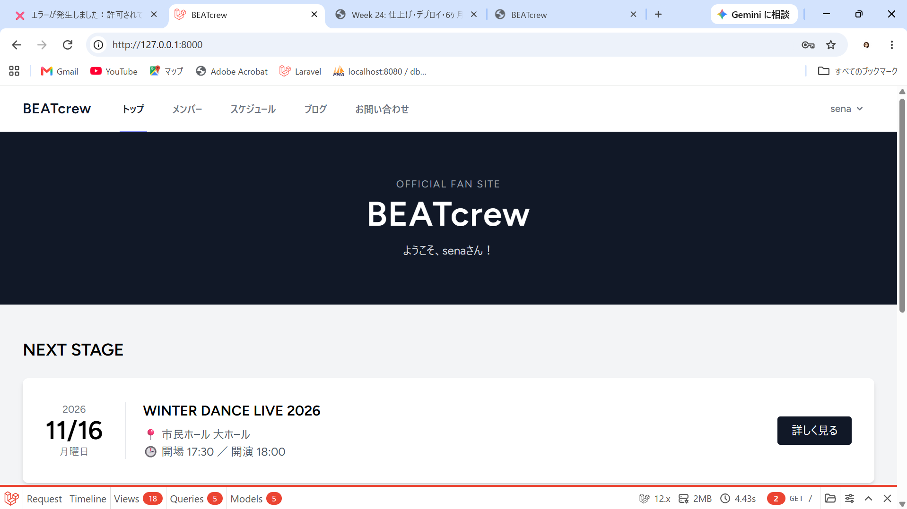
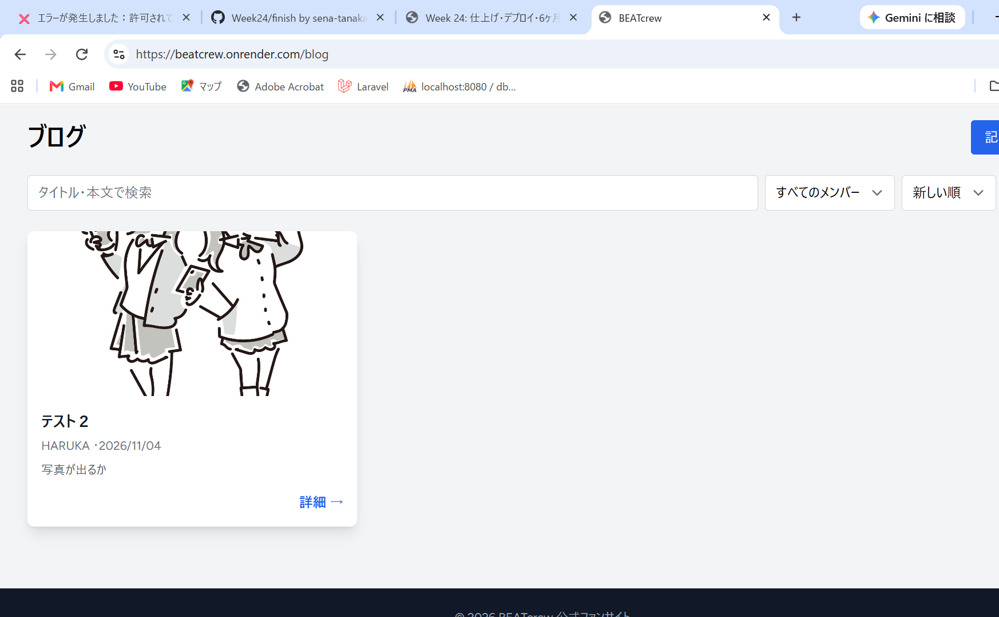
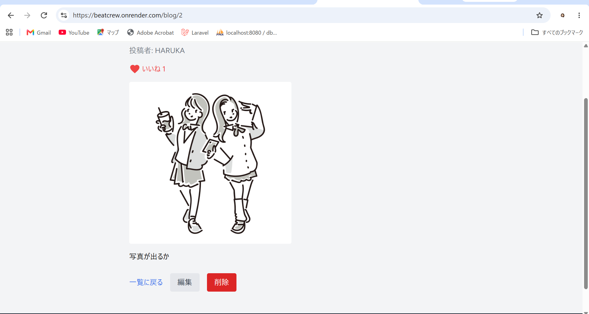
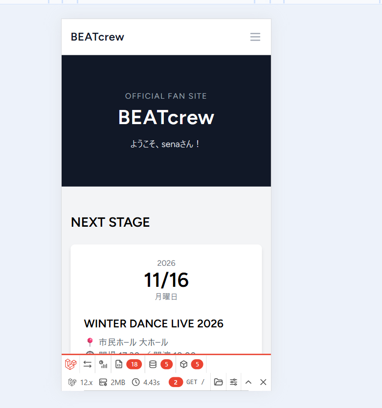

# BEATcrew ファンクラブ会員サイト

架空のヒップホップダンスチーム「BEATcrew」のファンクラブ会員サイトです（チーム名・メンバーは架空）。
チームの情報とダンサー本人の発信を会員限定のサイトにまとめ、ファンが「迷わず出演情報を見つけ、推しの日常に触れ、いいねで応援の気持ちを届けられる」ことを目指しました。

- **公開URL:** https://beatcrew.onrender.com
- **設計書:** [docs/](./docs/) フォルダ（要件定義書・設計書・スプリント計画）

### 確認用アカウント

サイト全体がログイン必須です。次のアカウントで中を確認できます。

| 種類 | メールアドレス | できること |
|------|--------------|-----------|
| ダンサー | haruka@example.com | ブログの投稿・自分の記事の編集・削除 ＋ ファンができること |
| ファン | fan@example.com | 閲覧・ブログのいいね・お問い合わせ |

本番環境のパスワードは、提出用の PR の本文で共有しています（ローカル環境では `password`）。

> 本番環境は Render の無料プランのため、しばらくアクセスがないと停止します。最初の表示に1分ほどかかることがあります。

## ✨ 主な機能

サイト全体がログイン必須です（会員登録・ログイン画面以外は、ログインしないと開けません）。

| 利用者 | できること |
|--------|-----------|
| 会員のファン | 閲覧・お問い合わせ・ブログのいいね |
| ダンサー | ファンの機能に加えて、ブログの投稿・自分の記事の編集・削除 |

### 必須機能
- ✅ 会員登録・ログイン・ログアウト（ログイン画面にチームの紹介を表示）
- ✅ ブログの投稿・一覧・詳細・編集・削除（CRUD）
- ✅ Policy による権限管理
  - ブログを投稿できるのはダンサーだけ
  - 編集・削除できるのは自分の記事だけ（他人の記事は 403）
- ✅ 検索・絞り込み（キーワード検索、メンバーで絞り込み、新しい順・古い順の並び替え）
- ✅ 画像アップロード（jpg・png・webp、2MBまで）
- ✅ いいね（Ajax。ページを再読み込みせずに登録・取り消し）

### そのほかの機能
- ✅ トップ（NEXT STAGE：直近の出演予定、チーム紹介）
- ✅ メンバー一覧（各メンバーのブログへのリンク付き）
- ✅ 出演スケジュール一覧・詳細（これからの出演と過去の出演、会場の地図リンク）
- ✅ お問い合わせ（入力・DB保存・完了画面）
- ✅ レスポンシブ対応（PC・タブレット・スマホ）

## 🛠 技術スタック

### バックエンド
- PHP 8.2
- Laravel 12.x / Laravel Breeze（Blade）
- MySQL 8.0（開発環境）/ PostgreSQL（本番環境）

### フロントエンド
- Blade
- Tailwind CSS
- Alpine.js

### インフラ
- Docker / Docker Compose（開発環境：Nginx・PHP-FPM・MySQL・phpMyAdmin）
- 本番環境: Render（Docker のマルチステージビルドでデプロイ）
- GitHub Actions（プッシュごとにテストを自動実行）

### 開発ツール
- Git / GitHub（Issues・Projects・Pull Request）
- Claude Code
- Laravel Debugbar
- PHPUnit

選定理由は [技術選定資料](./docs/06_tech-stack/tech-stack.md) を参照。デプロイ先は設計時は AWS（EC2・RDS）としていましたが、Week 24 で Render に変更しました。

## 📦 セットアップ方法

### 1. リポジトリのクローン
```bash
git clone https://github.com/sena-tanaka/fan-site.git
cd fan-site   # Laravel は src/、設計書は docs/ にある
```

### 2. 環境設定
```bash
cp .env.example .env           # Docker のポートの設定（Nginx 8000・MySQL 3306・phpMyAdmin 8080）
cp src/.env.example src/.env   # Laravel の設定
```

`src/.env` のデータベースの設定を、MySQL に変えます（`src/.env.example` は SQLite になっているため）。
```
DB_CONNECTION=mysql
DB_HOST=db
DB_PORT=3306
DB_DATABASE=laravel
DB_USERNAME=root
DB_PASSWORD=secret
```

### 3. 依存関係のインストール
```bash
docker compose up -d --build
docker compose exec app composer install
docker compose exec app php artisan key:generate
cd src && npm install && cd ..   # ホストPCで実行（app コンテナには Node.js が入っていないため）
```

### 4. マイグレーションと初期データ
```bash
docker compose exec app php artisan migrate --seed
docker compose exec app php artisan storage:link
```
メンバー3人、ダンサー3人とファン1人の確認用アカウント、出演スケジュールが作られます（パスワードは `password`）。

### 5. 開発サーバーの起動
```bash
docker compose up -d   # 3. で起動済みなら不要
cd src && npm run dev  # ホストPCで実行。ウィンドウは開いたままにする
```

| URL | 中身 |
|-----|------|
| http://127.0.0.1:8000 | アプリケーション |
| http://localhost:8080 | phpMyAdmin |

### 6. テストの実行
```bash
docker compose exec app php artisan test
```

## 📸 スクリーンショット

### トップページ


### ブログ一覧（検索・メンバーで絞り込み）


### ブログ詳細（いいね）


### スマホ表示


## 💡 工夫した点

1. **権限管理を Policy の1か所にまとめた**
   - 「誰が投稿・編集・削除できるか」は `PostPolicy` だけに書き、コントローラー（`authorize`）と Blade（`@can`）の両方から呼び出している
   - ボタンを隠すだけでなく、URL を直接開いたり、フォームを送ったりしても 403 になるようにした
   - ロールは Enum（`UserRole`）で管理し、会員登録のフォームからロールを書き換えられないよう `$fillable` に含めていない

2. **セキュリティ対策**
   - CSRF 保護（フォームは `@csrf`、Ajax は `X-CSRF-TOKEN` ヘッダー）
   - XSS 対策（ユーザーの入力はすべて `{{ }}` でエスケープ）
   - SQL インジェクション対策（Eloquent で検索・絞り込み）
   - ファイルアップロードのバリデーション、FormRequest でのバリデーションの分離

3. **パフォーマンス最適化**
   - N+1 問題を Eager Loading（`with('user.member')`）で解決し、Laravel Debugbar で一覧のクエリ数が記事数によらず一定になることを確認した

4. **テストと CI**
   - ログイン必須、ダンサーだけが投稿できること、他人の記事の編集・削除が 403 になること、いいねの登録・取り消しを Feature Test で確認している（全35件）
   - GitHub Actions でプッシュのたびにテストを自動実行している

5. **UI/UX**
   - Tailwind CSS でレスポンシブ対応
   - 記事・メンバー・スケジュールのカードを Blade コンポーネントにして見た目をそろえた
   - ヘッダーのメニューは配列で管理し、PC 用とスマホ用で同じ定義を使っている

6. **本番環境へのデプロイ**
   - Render の無料プランはシェルが使えないため、コンテナの起動時にマイグレーションと Seeder を実行している
   - Seeder は `updateOrCreate` で書き、何度実行してもデータが重複しないようにした
   - 確認用アカウントのパスワードは環境変数（`DEMO_PASSWORD`）で設定し、コードに書かないようにした

## ⚠️ 本番環境（Render 無料プラン）の制約

- アップロードした画像は、デプロイ・再起動のたびに消えます（画像アップロードの機能はローカル・本番の両方で動作を確認しています）
- 無料のデータベースは作成から30日で失効します

## 🚀 今後の拡張予定

要件定義書で Should / Could とした機能です（GitHub の Issue として残しています）。

### Should
- [ ] チームのダンス動画を見られるようにする（#8）
- [ ] グッズをカテゴリで絞り込んで見られるようにする（#9）

### Could
- [ ] 出演スケジュールをカレンダーで表示する（#5）
- [ ] 公式サイトでチケットを購入できるようにする（#12）、購入履歴を確認できるようにする（#16）
- [ ] 1日1回おみくじを引けるようにする（#13）
- [ ] 管理画面（出演スケジュール #20・チケットとグッズの価格や在庫 #21・メンバー情報 #22・YouTube の動画 #23・届いたお問い合わせの一覧 #24・注文の一覧 #25）

### 技術面
- [ ] 画像の保存先を S3 にして、本番でも画像が消えないようにする
- [ ] ログイン・会員登録画面などの日本語化

## 📅 開発の進め方

- 開発期間：Week 22〜24（3スプリント）。計画は合計 26 時間、Week 24 で持ち越した作業のために時間を増やした
- 計画と振り返り：[スプリント計画](./docs/sprint-plan.md)（実績との比較は Week 24 の PR に記載）
- タスク管理：GitHub Projects のボード（https://github.com/users/sena-tanaka/projects/1）
- 画面設計：[Figma のリンク](./docs/01_screen-design/figma.md)

## 📂 ドキュメント（docs/）

| フォルダ・ファイル | 内容 |
|------|------|
| [requirements.md](./docs/requirements.md) | 要件定義書（ペルソナ・MVP・ユーザーストーリー・機能要件・非機能要件） |
| [sprint-plan.md](./docs/sprint-plan.md) | スプリント計画（3スプリントのスケジュール） |
| [01_screen-design/](./docs/01_screen-design/) | 画面設計（Figma の URL・ワイヤーフレーム・画面遷移図） |
| [02_database/](./docs/02_database/) | DB設計書（テーブル定義・ER図） |
| [03_routing/](./docs/03_routing/) | ルーティング設計（Policy で守るルート・Ajax のルート） |
| [04_estimate/](./docs/04_estimate/) | 工数見積もり |
| [05_infrastructure/](./docs/05_infrastructure/) | インフラ構成図 |
| [06_tech-stack/](./docs/06_tech-stack/) | 技術選定資料（使用技術・デプロイ先の選定理由） |
| [practice/](./docs/practice/) | 練習課題（総合プロジェクトとは別の題材） |

## 📝 学習記録

このプロジェクトは、techmeets の AI駆動開発カリキュラム（6ヶ月）の集大成として作成しました。

### 習得した技術
- Laravel（MVC、認証、Eloquent ORM、Policy、FormRequest、Blade コンポーネント）
- Docker（コンテナ化、マルチステージビルド）
- Git/GitHub（Issue・PR を使った開発の流れ）
- AWS（EC2、RDS、S3）、Render へのデプロイ
- CI/CD（GitHub Actions）
- テスト（PHPUnit）
- 設計（要件定義、DB設計、ルーティング設計、スプリント計画）

## 👤 作成者

- GitHub: [@sena-tanaka](https://github.com/sena-tanaka)