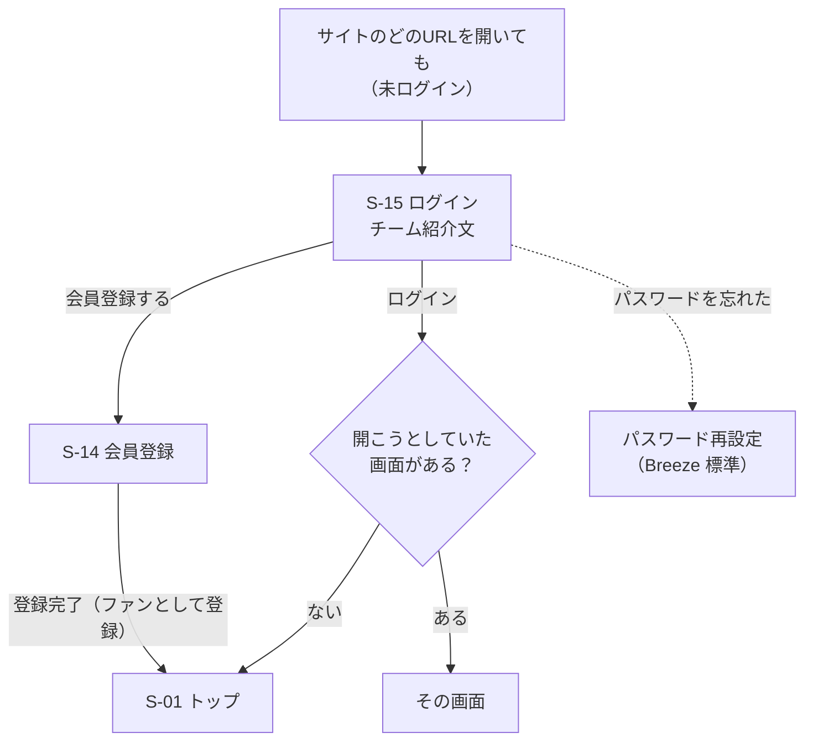
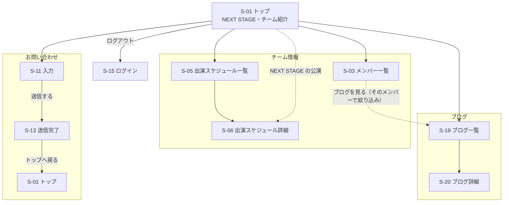
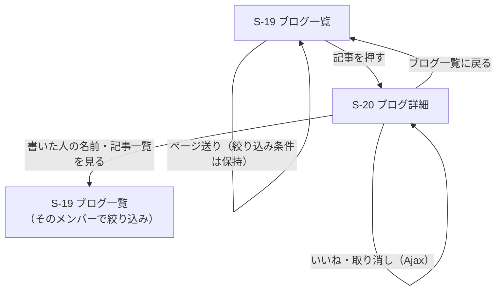
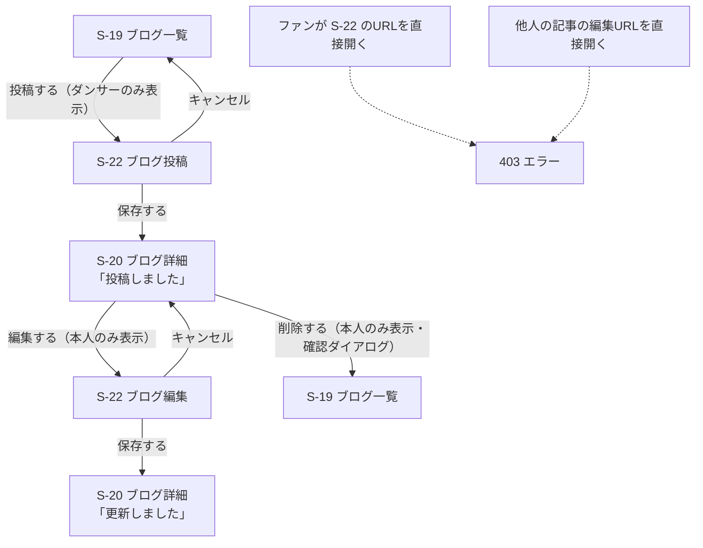

# 画面遷移図（Week 21 確定版）

> [要件定義書 7章](../requirements.md#7-画面遷移図)の内容を清書したもの。Figma の「03_Flow」ページはこの図をもとに描く。
> 画面ID（S-xx）は要件定義書 7.1、URL は [ルーティング設計](../03_routing/routes.md) と対応している。
> 今回（Week 22〜24）作る画面だけを描いている。

## 凡例

| 表記 | 意味 |
|------|------|
| 四角 | 自サイトの画面 |
| 実線 | 画面を移動する |
| 点線 | 条件によって移動する |
| （Ajax） | ページを再読み込みせず、同じ画面の中で表示が変わる |

サイト全体がログイン必須（F-29）。会員登録（S-14）とログイン（S-15）以外の画面は、ログインしないと開けない。

## 1. ログインまでの流れ

- ログイン後は、もともと開こうとしていた画面へ戻る。ログイン画面を直接開いた場合はトップへ
- ヘッダーの [ログアウト] を押すと、どの画面からでも S-15 に戻る

## 2. 全体（会員のファン・ダンサー共通）

どの画面からも、ヘッダーメニュー（トップ・メンバー・スケジュール・ブログ・お問い合わせ・ログアウト）で主要ページへ1クリックで移動できる（NF-14）。図が複雑になるため、ヘッダーからの矢印はトップからの矢印で代表させている。

- お問い合わせは確認画面（S-12・Should）を作らず、入力から直接送信する
- S-13 は送信後にリダイレクトで表示する。送信せずにURLを直接開いた場合は S-11 へ戻す

## 3. ブログ（会員のファン）

## 4. ブログ（ダンサー）

ダンサーは、会員のファンと同じ画面に加えて、ブログの投稿・編集・削除ができる。

- 投稿できるのはダンサーのみ（PostPolicy の create）、編集・削除は書いた本人のみ（PostPolicy の update・delete）
- 権限がない人には、[投稿する] [編集する] [削除する] のボタンを表示しない（NF-22）

## 今回は作らない画面

以下の画面は Should / Could のため、今回の遷移図には含めていない（要件定義書 7.1 を参照）。

| 画面ID | 画面名 | 優先度 |
|--------|--------|--------|
| S-02 | チーム紹介 | トップ（S-01）に統合 |
| S-04 | メンバー詳細 | Should |
| S-07 | ダンス動画一覧 | Should |
| S-08, S-09 | グッズ一覧・詳細 | Should |
| S-12 | お問い合わせ確認 | Should |
| S-21 | 自分の投稿一覧（いいね数） | Should |
| S-10, S-16, S-17 | 購入完了・チケット購入確認・マイページ | Could |
| S-18 | おみくじ | Could |
| S-23〜S-29 | 管理画面 | Could |