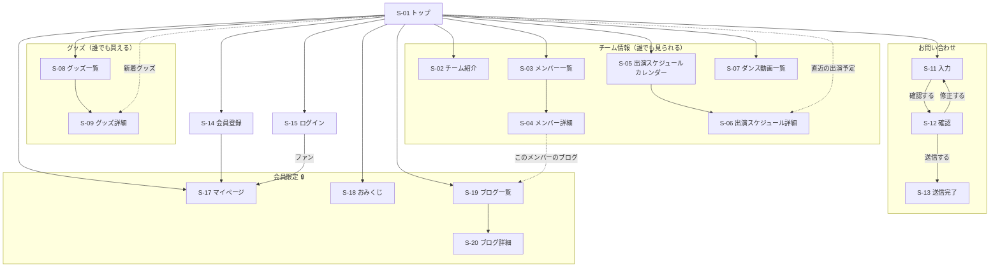
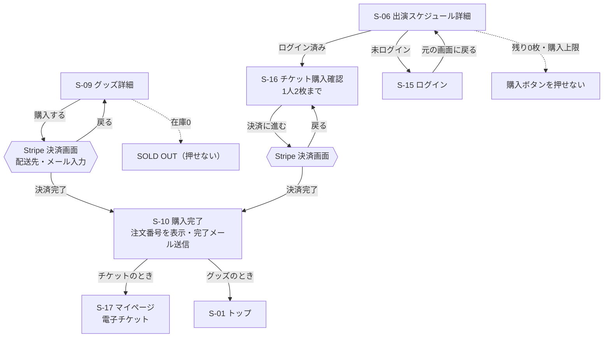
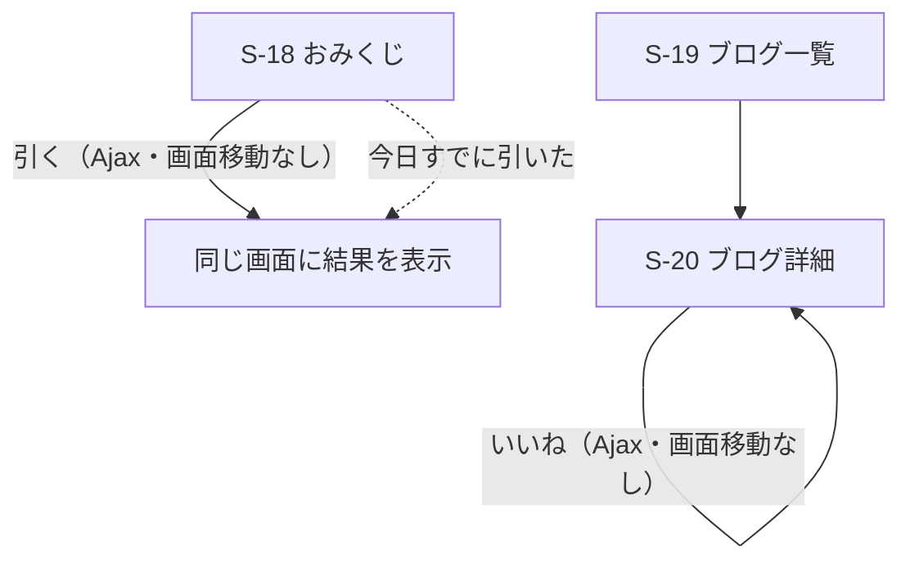
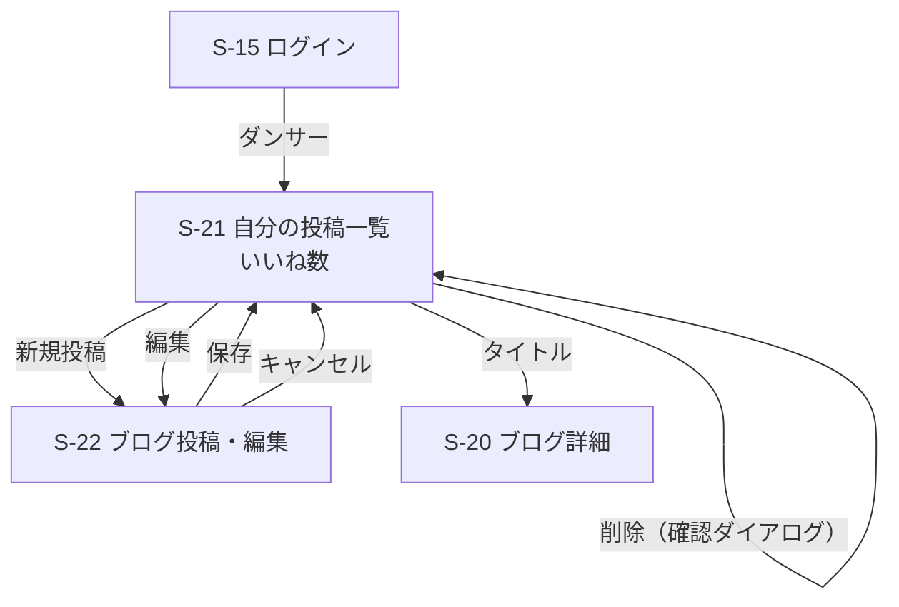
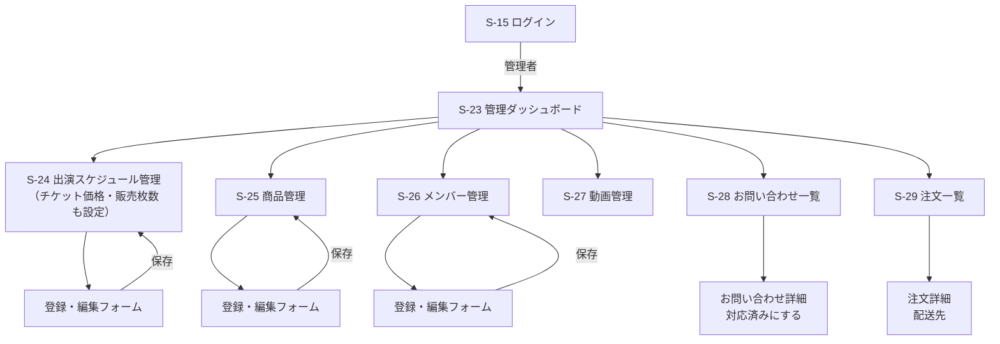

# 画面遷移図

> [要件定義書 5章](../requirements.md#5-画面遷移図)の簡易版を清書したもの。Figma の「03_Flow」ページはこの図をもとに描く。
> 画面ID（S-xx）は要件定義書 5.1、URL は [ルーティング設計](../03_routing/routes.md) と対応している。

## 凡例

| 表記 | 意味 |
|------|------|
| 四角 | 自サイトの画面 |
| 六角形 | 外部サービス（Stripe） |
| 🔒 | ログインが必要（未ログインならログイン画面へ。ログイン後は元の画面に戻る） |
| 点線 | 条件によって移動する |

## 1. 全体（ファン向け）

どの画面からも、ヘッダーメニューで主要ページへ1クリックで移動できる（NF-14）。図が複雑になるため、ヘッダーからの矢印はトップからの矢印で代表させている。

## 2. 購入の流れ

## 3. おみくじ・ブログ（会員）

## 4. ダンサー向け

ダンサーも会員と同じくファン向け画面（ブログ一覧・おみくじなど）を見られる。ヘッダーに「自分の投稿」が増える。

## 5. 管理者向け

管理画面の登録・編集フォームは、要件定義書の画面一覧では各管理画面（S-24〜S-29）に含めている。ルーティング設計では別のURL（`/create`・`/{id}/edit`）になる。
