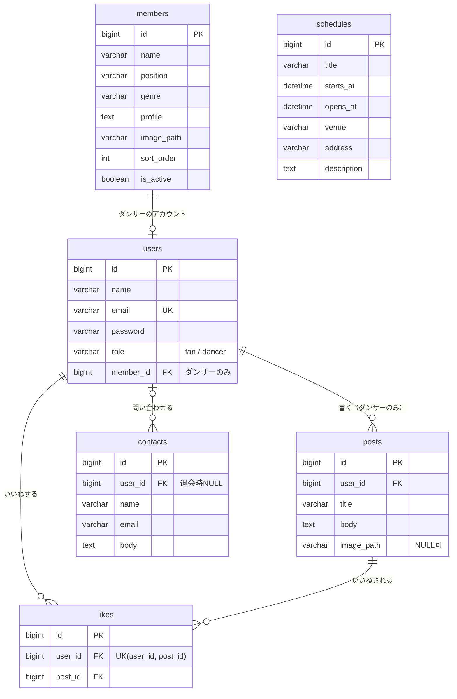

# ER図（Week 21 確定版）

> 各カラムの詳しい説明は [テーブル定義](./tables.md) を参照。
> 記法：`||` = ちょうど1、`o|` = 0か1、`|{` = 1以上、`o{` = 0以上。
> 今回（Week 22〜24）作るテーブルだけを描いている。

`schedules` はほかのテーブルとつながりがないため、図では単独で置いている。`created_at`・`updated_at` は全テーブルにあるが、図では省略している。

今回は作らないテーブル（products・orders・order_items・videos・fortunes・fortune_draws）は、[テーブル定義 4章](./tables.md#4-今回は作らないテーブル) を参照。