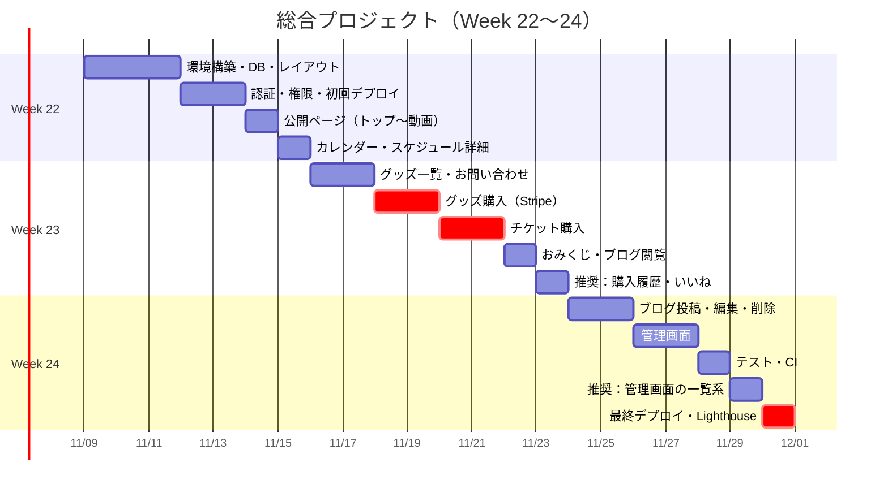

# スケジュール

> 各作業の工数は [estimate.md](./estimate.md) を参照。
> 1週間 35h（平日 4h・休日 7.5h）と仮定している。実際の曜日・使える時間は Week 21 で見直す。

## 1. 全体の流れ

| 週 | テーマ | ゴール（この週の終わりにできていること） | 工数 |
|----|--------|----------------------------------------|-----:|
| Week 19〜20 | 設計（初版） | この設計書一式と Figma の初版 | — |
| Week 21 | 設計の確定 | 設計を見直して確定。Figma を清書し、要件定義書との食い違いを直す | — |
| **Week 22** | 土台と公開ページ | ログインでき、誰でも見られるページ（トップ〜動画）が本番環境で表示できる | 35.5h |
| **Week 23** | 購入と会員機能 | グッズ・チケットを Stripe（テスト）で買える。おみくじ・ブログが会員だけ見られる | 33h |
| **Week 24** | ダンサー・管理者・仕上げ | ダンサーが投稿でき、管理者がデータを管理できる。テスト・本番デプロイまで完了 | 32.5h |

先に土台と本番デプロイを済ませ、一番難しい購入（Stripe）を真ん中の週に置いている。最終週に問題が見つかっても、管理画面や推奨機能を削って間に合わせられる順番にした。

## 2. 週ごとの予定

### Week 22：土台と公開ページ

| 日 | 時間 | 作業 | 機能ID |
|----|-----:|------|--------|
| Day 1（平日） | 4h | 環境構築（Laravel・Docker・Breeze・S3 / Stripe / Mailpit の設定） | — |
| Day 2（平日） | 4h | マイグレーション・モデル・リレーション・シーダー | — |
| Day 3（平日） | 4h | 共通レイアウト（ヘッダー・フッター・管理画面）、チーム紹介 | F-05 |
| Day 4（平日） | 4h | 会員登録・ログイン、権限管理（Gate） | F-01〜03 |
| Day 5（平日） | 4h | 権限管理（Policy の土台）、**初回デプロイ**（EC2・RDS・HTTPS） | F-03 |
| Day 6（休日） | 8h | トップ、メンバー一覧・詳細、ダンス動画一覧 | F-04, 06, 09 |
| Day 7（休日） | 7.5h | 出演スケジュール（カレンダー・Ajax）、スケジュール詳細 | F-07, 08 |

### Week 23：購入と会員機能

| 日 | 時間 | 作業 | 機能ID |
|----|-----:|------|--------|
| Day 1（平日） | 4h | グッズ一覧・詳細、お問い合わせ（入力画面） | F-11, 10 |
| Day 2（平日） | 4h | お問い合わせ（確認・完了・通知メール）、Stripe CLI の準備 | F-10, 12 |
| Day 3（平日） | 4h | グッズ購入（決済開始・在庫確保・購入完了画面） | F-12 |
| Day 4（平日） | 4h | グッズ購入（Webhook・完了メール・テスト）、チケット購入の画面 | F-12, 14 |
| Day 5（平日） | 4h | チケット購入（枚数制限・残り枚数・Webhook） | F-14 |
| Day 6（休日） | 7.5h | チケット購入（テスト）、おみくじ、会員限定ブログ閲覧 | F-14, 16, 17 |
| Day 7（休日） | 7.5h | 【推奨】購入履歴、いいね ／ 予備 2h | F-15, 18 |

### Week 24：ダンサー・管理者・仕上げ

| 日 | 時間 | 作業 | 機能ID |
|----|-----:|------|--------|
| Day 1（平日） | 4h | ブログ投稿・編集・削除（S3 画像） | F-19, 20 |
| Day 2（平日） | 4h | ブログ（テスト）、管理ダッシュボード、スケジュール管理 | F-19, 20, 22 |
| Day 3（平日） | 4h | スケジュール管理（テスト）、商品管理 | F-22, 23 |
| Day 4（平日） | 4h | 商品管理（テスト）、メンバー管理 | F-23, 24 |
| Day 5（平日） | 4h | テストの追加・カバレッジ確認、CI の設定 | NF-19, 20 |
| Day 6（休日） | 6.5h | 【推奨】いいね数の確認、動画管理、お問い合わせ一覧、注文一覧 | F-21, 26〜28 |
| Day 7（休日） | 7.5h | **最終デプロイ**、Lighthouse 計測と改善、提出準備（README・PR） ／ 予備 1.5h | NF-01, 02 |

## 3. ガントチャート

赤色（crit）は遅れると全体に影響する作業。日付は「Week 19 が 2026/10/19（月）から始まり、1週ずつ進む」と仮定して入れている（Week 22 = 11/9〜11/15）。実際の日程に合わせて Week 21 で直す。

## 4. 進め方のルール

- ブランチは機能ごとに切る（例：`week22/schedule-calendar`）。1機能ごとに PR を作ってマージする（Week 5 以降と同じ流れ）
- 各週の最終日に「必須が終わっているか」を確認し、遅れていれば次の週の推奨を削る（[estimate.md 4章](./estimate.md#4-遅れたときに削る順番)）
- 予備時間は前倒しで使わず、遅れの吸収に使う
