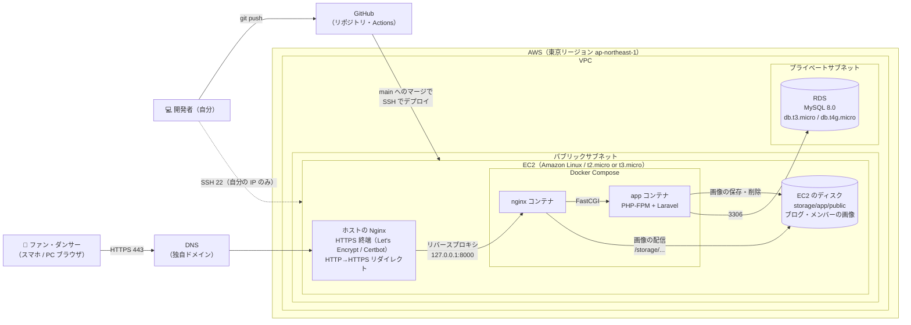

# インフラ構成図（Week 21 確定版）

> デプロイ先：**A. AWS を使い続ける**（要件定義書 1.7・NF-16・C-03）
> Week 11（EC2 + RDS）、Week 13（独自ドメイン・Nginx・HTTPS）、Week 15（GitHub Actions の自動デプロイ）で作った構成をもとにしている。
> 今回（Week 22〜24）作る範囲の構成。S3・Stripe・メール送信は今回使わない（6章）。

## 1. 選んだ理由

| 比べたこと | A. AWS（採用） | B. Render など |
|-----------|---------------|---------------|
| これまでの経験 | Week 11〜17 で構築・デプロイ済み。同じ環境を流用できる | 新しく覚える必要がある |
| 開発時間（26h）への影響 | 環境づくりの時間がほぼかからず、機能開発に時間を回せる | 移行と動作確認に時間がかかる |
| 画像の保存（ローカル） | EC2 のディスクに保存し続けられる | 無料プランではディスクが消える（再起動で画像がなくなる）ため、外部ストレージが必要になる |
| 費用 | 無料利用枠内（C-03）。期限・使いすぎに注意 | 無料プランはスリープや DB の期限がある |
| 手間 | サーバーの設定・更新を自分で行う | 設定が少ない |

## 2. 構成図

## 3. 各サービスの役割

| サービス | 役割 | 関係する要件 |
|---------|------|------------|
| DNS（独自ドメイン） | Week 13 で取得したドメインを EC2 の Elastic IP に向ける | NF-05 |
| EC2 | Web サーバー。ホストの Nginx が HTTPS を受け、Docker の Laravel に転送する | NF-16 |
| ホストの Nginx + Certbot | Let's Encrypt の証明書で HTTPS 化。HTTP は HTTPS にリダイレクト | NF-05 |
| Docker（nginx / app） | 開発環境と同じコンテナ構成で Laravel を動かす。本番は Week 16 で作った軽量な Dockerfile を使う | C-04 |
| EC2 のディスク（storage/app/public） | ブログ・メンバーの画像を保存する。`php artisan storage:link` で `public/storage` から公開する | F-19, NF-17 |
| RDS（MySQL） | データベース。プライベートサブネットに置き、EC2 からだけ接続できる | NF-16 |
| GitHub Actions | push 時にテスト、main へのマージで EC2 に自動デプロイ（Week 15） | NF-20 |

## 4. セキュリティグループ

| 対象 | 方向 | ポート | 許可する相手 | 理由 |
|------|------|-------|-------------|------|
| EC2 | 受信 | 443（HTTPS） | 0.0.0.0/0 | 会員がサイトを使えるようにする（ログインはアプリ側で必須にする） |
| EC2 | 受信 | 80（HTTP） | 0.0.0.0/0 | HTTPS へのリダイレクトと、Certbot の証明書更新に使う |
| EC2 | 受信 | 22（SSH） | 自分の IP ／ GitHub Actions ※ | サーバー操作とデプロイ |
| RDS | 受信 | 3306（MySQL） | EC2 のセキュリティグループ | アプリからだけ DB に接続できるようにする（インターネットからは接続不可） |

※ GitHub Actions の接続元 IP は毎回変わるため、Week 15 と同じ方法（　　　　　　　　　）で運用する。

## 5. 画像をローカルに保存するための設定

| 項目 | 設定 | 理由 |
|------|------|------|
| 画像の保存場所 | `storage/app/public` を、ホスト（EC2）のディレクトリにマウントする（docker-compose の volumes） | コンテナの中にだけ保存すると、デプロイでコンテナを作り直したときに画像が消えるため |
| 公開用のリンク | デプロイ時に `php artisan storage:link` を実行する（GitHub Actions のデプロイ手順に入れる） | `public/storage` から画像を表示するため |
| 書き込みの権限 | `storage` と `bootstrap/cache` を、PHP-FPM の実行ユーザーが書き込めるようにする | 権限がないと保存時に 500 エラーになるため |
| アップロードできるサイズ | ホストの Nginx とコンテナの Nginx の両方で `client_max_body_size 5M;` を設定する | 初期値の 1MB のままだと、2MB までの画像（NF-11）が 413 エラーになるため。余裕を持たせて 5M にする |
| PHP の上限 | `upload_max_filesize = 2M`（初期値のまま）、`post_max_size = 8M`（初期値のまま） | NF-11 の 2MB と合っているため、変更しない |
| `.gitignore` | `storage/app/public/*` は Git に入れない（Laravel の初期設定のまま） | アップロードされた画像をリポジトリに含めないため |

- メンバーの画像は Seeder で `storage/app/public/members/` に配置する
- 画像のバックアップは取らない（学習用のため）。EC2 を作り直すと画像は消える

## 6. 秘密情報の管理（NF-10）

| 情報 | 置き場所 |
|------|---------|
| DB のパスワード、`APP_KEY` | EC2 上の `.env`（Git に入れない） |
| SSH 秘密鍵・デプロイ先の情報 | GitHub の Secrets |

## 7. 開発環境との違い

| 項目 | 開発環境（ローカル） | 本番環境（AWS） |
|------|-------------------|----------------|
| URL | http://localhost:8000 | https://（独自ドメイン） |
| DB | db コンテナ（MySQL） | RDS |
| 画像 | ローカルの `storage/app/public` | EC2 の `storage/app/public`（ホストにマウント） |
| phpMyAdmin | あり（8080） | 置かない |
| `APP_DEBUG` | true | false |

## 8. 今回は使わないサービス

Should / Could の機能を作るときに追加する。

| サービス | 使う機能 | 優先度 |
|---------|---------|--------|
| S3（＋CloudFront） | 画像の保存先を S3 にする（F-33） | Could |
| Stripe | グッズ・チケット購入（F-12, F-14） | Could |
| メール送信サービス（Amazon SES など）・Mailpit | 購入完了メール・お問い合わせ通知 | Could |
| YouTube（埋め込み） | ダンス動画一覧（F-09）。サーバー側の設定は不要 | Should |

## 9. 確認すること

- [ ] AWS の無料プランの期限・残りクレジット（Week 11 で使ったアカウントのままで Week 24 まで足りるか。請求ダッシュボードで確認する）
- [ ] GitHub Actions からの SSH の許可方法を、4章の※に書く