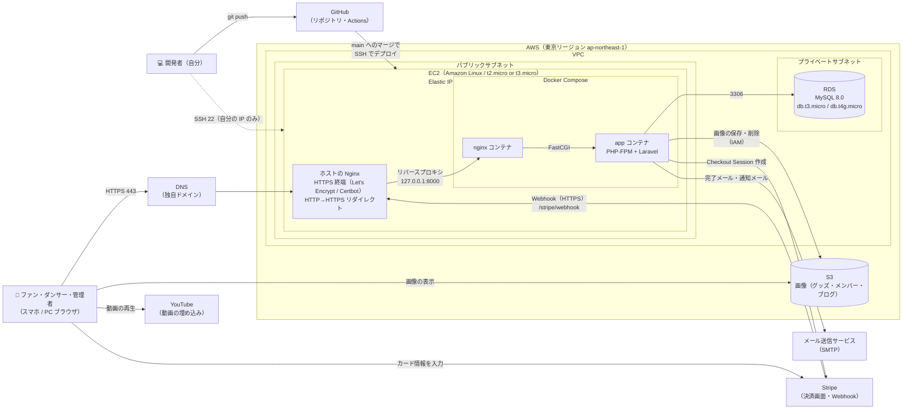

# インフラ構成図

> デプロイ先：**A. AWS を使い続ける**（要件定義書 1.7・NF-16・C-03）
> Week 11（EC2 + RDS）、Week 11 練習（S3）、Week 13（独自ドメイン・Nginx・HTTPS）、Week 15（GitHub Actions の自動デプロイ）で作った構成をもとにしている。

## 1. 選んだ理由

| 比べたこと | A. AWS（採用） | B. Render など |
|-----------|---------------|---------------|
| これまでの経験 | Week 11〜17 で構築・デプロイ済み | 新しく覚える必要がある |
| 要件との一致 | 要件定義書で EC2・RDS・S3 を使うと決めている | 要件定義書の書き換えが必要 |
| 費用 | 無料利用枠内（C-03）。期限・使いすぎに注意 | 無料プランはスリープや DB の期限がある |
| 手間 | サーバーの設定・更新を自分で行う | 設定が少ない |

## 2. 構成図

## 3. 各サービスの役割

| サービス | 役割 | 関係する要件 |
|---------|------|------------|
| DNS（独自ドメイン） | Week 13 で取得したドメインを EC2 の Elastic IP に向ける | NF-05 |
| EC2 | Web サーバー。ホストの Nginx が HTTPS を受け、Docker の Laravel に転送する | NF-16 |
| ホストの Nginx + Certbot | Let's Encrypt の証明書で HTTPS 化。HTTP は HTTPS にリダイレクト | NF-05 |
| Docker（nginx / app） | 開発環境と同じコンテナ構成で Laravel を動かす。本番は Week 16 で作った軽量な Dockerfile を使う | C-04 |
| RDS（MySQL） | データベース。プライベートサブネットに置き、EC2 からだけ接続できる | NF-16 |
| S3 | グッズ・メンバー・ブログの画像を保存。画像は WebP に変換して軽くする（Week 17 練習） | NF-04 |
| Stripe | 決済画面と決済処理。カード情報は自サーバーを通らない。決済結果は Webhook で受け取る | NF-09, C-05 |
| YouTube | ダンス動画。サーバーには保存せず、ブラウザが YouTube から直接読み込む | C-06 |
| メール送信サービス | 購入完了メール・お問い合わせ通知を送る。開発環境では Mailpit（NF-17, C-07） | F-10, F-12, F-14 |
| GitHub Actions | push 時に Lint とテスト、main へのマージで EC2 に自動デプロイ（Week 15） | NF-20 |

## 4. セキュリティグループ

| 対象 | 方向 | ポート | 許可する相手 | 理由 |
|------|------|-------|-------------|------|
| EC2 | 受信 | 443（HTTPS） | 0.0.0.0/0 | 誰でもサイトを見られるようにする |
| EC2 | 受信 | 80（HTTP） | 0.0.0.0/0 | HTTPS へのリダイレクトと、Certbot の証明書更新に使う |
| EC2 | 受信 | 22（SSH） | 自分の IP ／ GitHub Actions ※ | サーバー操作とデプロイ |
| RDS | 受信 | 3306（MySQL） | EC2 のセキュリティグループ | アプリからだけ DB に接続できるようにする（インターネットからは接続不可） |

※ GitHub Actions の接続元 IP は毎回変わる。Week 15 と同じ方法（例：デプロイのときだけ SSH を一時的に許可する、または 22 を広く開けて鍵認証のみにする）で運用する。どちらにするかは Week 21 で決める。

## 5. 秘密情報の管理（NF-10）

| 情報 | 置き場所 |
|------|---------|
| DB のパスワード、Stripe のシークレットキー・Webhook 署名シークレット、メールの SMTP パスワード | EC2 上の `.env`（Git に入れない） |
| S3 へのアクセス | EC2 に IAM ロールを付ける（アクセスキーを `.env` に書かない）。付けられない場合は S3 だけ操作できる IAM ユーザーのキーを `.env` に置く |
| SSH 秘密鍵・デプロイ先の情報 | GitHub の Secrets |

## 6. 開発環境との違い

| 項目 | 開発環境（ローカル） | 本番環境（AWS） |
|------|-------------------|----------------|
| URL | http://localhost:8000 | https://（独自ドメイン） |
| DB | db コンテナ（MySQL） | RDS |
| 画像 | S3（開発用のバケットを分ける）またはローカル保存 | S3 |
| メール | Mailpit コンテナ（実際には送らない） | メール送信サービス |
| Stripe Webhook | Stripe CLI（`stripe listen --forward-to localhost:8000/stripe/webhook`） | Stripe のダッシュボードに本番 URL を登録 |
| phpMyAdmin | あり（8080） | 置かない |

## 7. Week 21 で決めること

- メール送信サービス：Amazon SES（サンドボックスでは検証済みのアドレスにしか送れない）か、Gmail の SMTP などの無料の方法か
- 画像の配信に CloudFront を使うか（Week 17 練習 3 で試した場合）
- AWS の無料プランの期限・残りクレジットの確認（Week 11 で使ったアカウントのままで Week 24 まで足りるか。請求ダッシュボードで確認する）
- GitHub Actions からの SSH の許可方法（4章の※）
