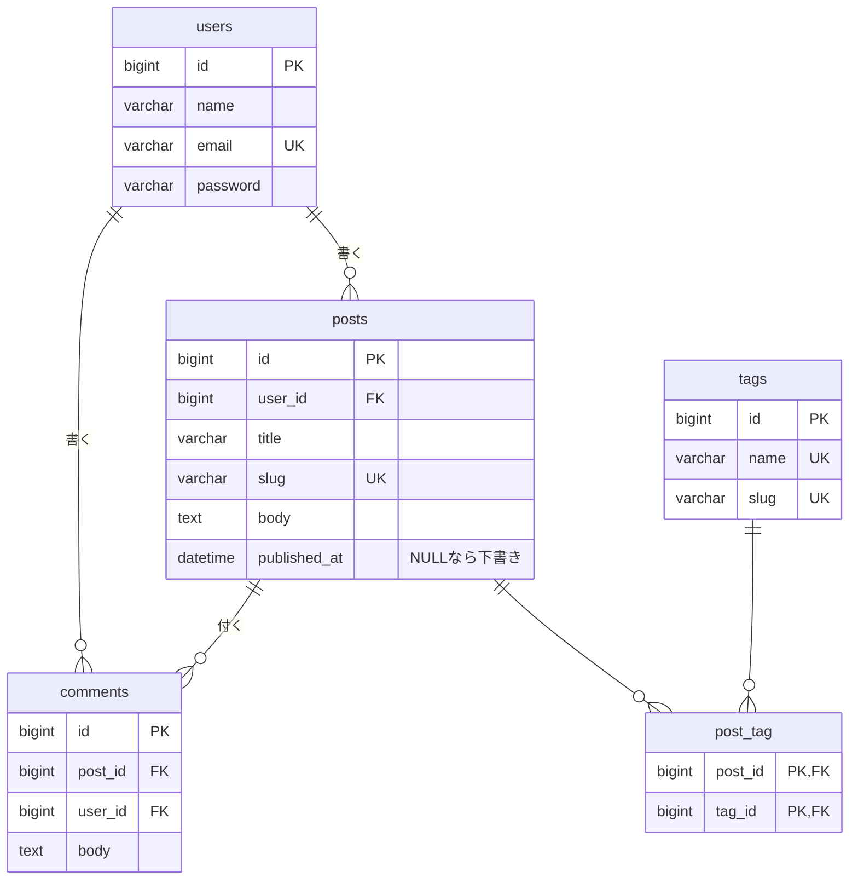

# 練習課題2：ブログシステムのDB設計書

> 総合プロジェクトとは別の練習用の題材。ユーザーが記事を書き、記事にコメントとタグを付けられるブログシステム。

## 1. 前提（決めたこと）

| 項目 | 決めたこと |
|------|-----------|
| 記事を書ける人 | 登録ユーザー |
| コメントできる人 | 登録ユーザーのみ（名前を表示するため） |
| タグ | 1記事に複数付けられる。1つのタグは複数の記事に付く（多対多） |
| 下書き | あり（公開日時が空なら下書き） |
| 削除 | ユーザーを削除したら、その人の記事・コメントも消す |

## 2. テーブル一覧

| No | テーブル名 | 論理名 | 概要 |
|----|-----------|--------|------|
| 1 | users | ユーザー | 記事・コメントを書く人 |
| 2 | posts | 記事 | ブログ記事 |
| 3 | comments | コメント | 記事へのコメント |
| 4 | tags | タグ | 記事の分類（Laravel・PHP など） |
| 5 | post_tag | 記事タグ（中間テーブル） | 記事とタグの多対多をつなぐ |

posts と tags は多対多なので、そのままではつなげられない。間に中間テーブル `post_tag` を置く（Laravel の命名ルール：2つのテーブルの単数形をアルファベット順に `_` でつなぐ）。

## 3. ER図



## 4. テーブル定義

全テーブルに `created_at`・`updated_at`（TIMESTAMP, NULL 可）がある（post_tag を除き、表では省略）。

### 4.1 users

| カラム名 | 型 | NULL | 初期値 | キー・制約 | 説明 |
|---------|----|------|--------|-----------|------|
| id | BIGINT UNSIGNED | × | | PK | |
| name | VARCHAR(50) | × | | | 表示名 |
| email | VARCHAR(255) | × | | UNIQUE | ログインID |
| email_verified_at | TIMESTAMP | ○ | NULL | | |
| password | VARCHAR(255) | × | | | ハッシュ化して保存 |
| remember_token | VARCHAR(100) | ○ | NULL | | |

### 4.2 posts

| カラム名 | 型 | NULL | 初期値 | キー・制約 | 説明 |
|---------|----|------|--------|-----------|------|
| id | BIGINT UNSIGNED | × | | PK | |
| user_id | BIGINT UNSIGNED | × | | FK → users.id（CASCADE）, INDEX | 書いた人 |
| title | VARCHAR(255) | × | | | タイトル |
| slug | VARCHAR(255) | × | | UNIQUE | URL 用の文字列（例：`/posts/laravel-tips`） |
| body | TEXT | × | | | 本文 |
| published_at | DATETIME | ○ | NULL | INDEX | 公開日時。NULL は下書き。新着順の並び替えに使うのでインデックス |

### 4.3 comments

| カラム名 | 型 | NULL | 初期値 | キー・制約 | 説明 |
|---------|----|------|--------|-----------|------|
| id | BIGINT UNSIGNED | × | | PK | |
| post_id | BIGINT UNSIGNED | × | | FK → posts.id（CASCADE）, INDEX | どの記事へのコメントか。記事を消したらコメントも消す |
| user_id | BIGINT UNSIGNED | × | | FK → users.id（CASCADE） | 書いた人 |
| body | TEXT | × | | | コメント本文（1000文字まで。アプリのバリデーションで制限） |

### 4.4 tags

| カラム名 | 型 | NULL | 初期値 | キー・制約 | 説明 |
|---------|----|------|--------|-----------|------|
| id | BIGINT UNSIGNED | × | | PK | |
| name | VARCHAR(50) | × | | UNIQUE | タグ名（同じ名前のタグを2つ作らない） |
| slug | VARCHAR(50) | × | | UNIQUE | URL 用（例：`/tags/laravel`） |

### 4.5 post_tag（中間テーブル）

| カラム名 | 型 | NULL | 初期値 | キー・制約 | 説明 |
|---------|----|------|--------|-----------|------|
| post_id | BIGINT UNSIGNED | × | | PK（複合）, FK → posts.id（CASCADE） | |
| tag_id | BIGINT UNSIGNED | × | | PK（複合）, FK → tags.id（CASCADE）, INDEX | タグから記事を探すときに使う |
| created_at | TIMESTAMP | ○ | NULL | | タグを付けた日時 |

- `PRIMARY KEY(post_id, tag_id)` にして、同じ記事に同じタグが2回付かないようにする
- 複合主キーは左の `post_id` からしか検索に使えないため、`tag_id` にも別にインデックスを付ける（タグ別の記事一覧で使う）

## 5. Laravel のリレーション

```php
// User
public function posts()    { return $this->hasMany(Post::class); }
public function comments() { return $this->hasMany(Comment::class); }

// Post
public function user()     { return $this->belongsTo(User::class); }
public function comments() { return $this->hasMany(Comment::class); }
public function tags()     { return $this->belongsToMany(Tag::class)->withTimestamps(); }

// Comment
public function post()     { return $this->belongsTo(Post::class); }
public function user()     { return $this->belongsTo(User::class); }

// Tag
public function posts()    { return $this->belongsToMany(Post::class); }
```

- 記事一覧では `Post::with(['user', 'tags'])->withCount('comments')` として N+1 を防ぐ
- タグの付け替えは `$post->tags()->sync($tagIds)` で、中間テーブルの追加・削除をまとめて行う

## 6. マイグレーションの順番

外部キーで参照される側を先に作る。

1. users
2. tags
3. posts（users を参照）
4. comments（posts・users を参照）
5. post_tag（posts・tags を参照）
