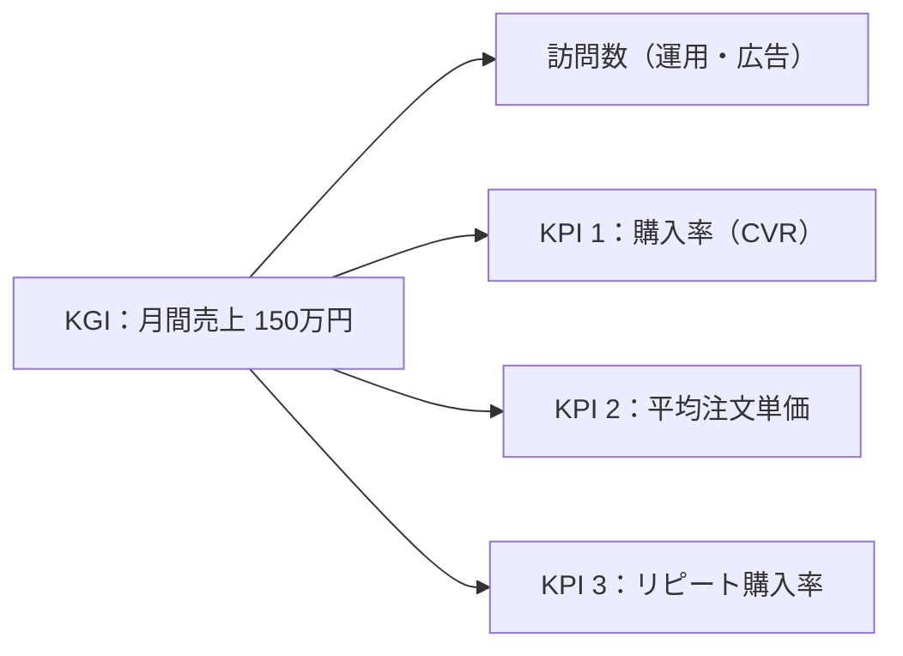

# 練習課題2：ECサイトのKPI設定

> 総合プロジェクトとは別の練習用の題材。架空の雑貨ECサイト「MONO STORE」（[画面設計](./ec-screen-design.md)・[スプリント計画](./ec-sprint-plan.md)）のKPIを設定する。
> 数値はすべて練習用の仮の値。

## 1. KGI（最終的なゴール）

| KGI | 目標 |
|-----|------|
| 月間売上 | 公開から6か月後に **月 150万円** |

ECサイトの売上は、次の3つのかけ算に分けられる。

```
売上 ＝ 訪問数（セッション数） × 購入率（CVR） × 平均注文単価
150万円 ＝ 30,000 セッション × 2.0% × 2,500円
```

このうち、**サイトの作り（開発）で直接よくできる**のは「購入率」と「平均注文単価」。
訪問数は広告やSNSの運用で増やすものなので、KPIにはサイトの改善につながる2つと、売上を安定させる「リピート購入率」を選んだ。



## 2. KPI

### KPI 1：購入率（CVR）

| 項目 | 内容 |
|------|------|
| 定義 | サイトに来た人のうち、購入まで進んだ人の割合 |
| 計算式 | 購入完了数 ÷ セッション数 × 100 |
| 目標 | **2.0%以上**（公開直後は 1.0% を目安にし、6か月で 2.0% にする） |
| なぜこの指標か | 訪問数が同じでも、買いやすいサイトなら売上が増える。「探しにくい」「カートで離脱する」など、サイトの使いにくさがそのまま数字に出る |
| 計測方法 | セッション数は Google Analytics 4、購入完了数は orders テーブル（Stripe の決済完了） |
| 関連する機能 | 絞り込み・並び替え（T-06）、検索（T-07）、カート（T-10）、決済（T-12） |
| 改善の例 | カートに入れたのに買わなかった人の割合（カゴ落ち率）を見て、購入手続きの入力項目を減らす。検索で0件になったキーワードを見て、商品名や説明を見直す |

### KPI 2：平均注文単価

| 項目 | 内容 |
|------|------|
| 定義 | 1回の注文あたりの平均金額 |
| 計算式 | 売上 ÷ 注文数 |
| 目標 | **2,500円以上**（商品の価格帯が 1,000〜3,000円なので、「2点買い」を増やす） |
| なぜこの指標か | 雑貨は1点あたりの値段が安いため、1回で複数買ってもらえるかで売上が大きく変わる。送料の負担も1注文あたりで薄まる |
| 計測方法 | orders テーブルの合計金額 ÷ 注文件数（管理画面の注文一覧で月ごとに集計） |
| 関連する機能 | 商品詳細の関連商品（T-08）、カート（T-10） |
| 改善の例 | 「あと〇〇円で送料無料」をカートに表示する。商品詳細の関連商品に、一緒に買われやすい商品を出す |

### KPI 3：リピート購入率

| 項目 | 内容 |
|------|------|
| 定義 | 一度買った人のうち、90日以内にもう一度買った人の割合 |
| 計算式 | 90日以内に2回目の購入をした会員数 ÷ その期間に初めて購入した会員数 × 100 |
| 目標 | **20%以上** |
| なぜこの指標か | 新しいお客さんを広告で集めるより、一度買った人にまた来てもらうほうが費用がかからない。売上を毎月安定させるのに欠かせない |
| 計測方法 | orders テーブルを会員ごとに集計する（会員登録して購入した人が対象） |
| 関連する機能 | 会員登録（T-09）、注文履歴（T-15）、お気に入り（T-19）、レビュー（T-20）、お知らせ（T-22） |
| 改善の例 | お気に入りに入れた商品が再入荷・値下げしたらメールで知らせる。レビューを書いた人に次回使えるクーポンを渡す |

## 3. まとめ

| KPI | 目標 | 主に改善するスプリント |
|-----|------|----------------------|
| 購入率（CVR） | 2.0%以上 | Sprint 1（探しやすさ）・Sprint 2（買いやすさ） |
| 平均注文単価 | 2,500円以上 | Sprint 1（関連商品）・Sprint 2（カート） |
| リピート購入率 | 20%以上 | Sprint 3（お気に入り・レビュー） |

- 3つとも「サイトの機能を変えると数字が変わる」ものを選んだので、リリース後に改善の効果を確かめやすい
- 数値は公開後1か月の実績を見て見直す