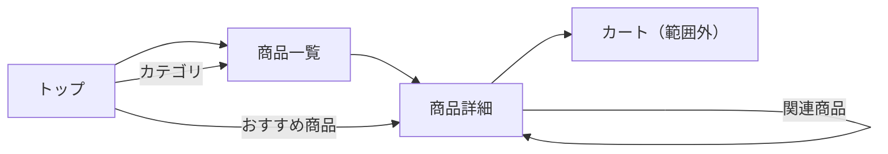

# 練習課題1：ECサイトの画面設計（Figma）

> 総合プロジェクトとは別の練習用の題材。架空の雑貨ECサイト「MONO STORE」のトップページ・商品一覧・商品詳細を設計する。

## Figma URL

| 内容 | URL |
|------|-----|
| ワイヤーフレーム（3画面・SP / PC） | https://www.figma.com/design/FNwNB2GY7CTtbpcXwN1V9z/MONO-STORE%EF%BC%88%E7%B7%B4%E7%BF%92%EF%BC%89?node-id=0-1&t=v99kYT5J27gFHLgK-1 |

※ 共有設定は「リンクを知っている全員」「閲覧可」にする。

## 前提

| 項目 | 内容 |
|------|------|
| 想定ユーザー | 20〜30代。暮らしの雑貨をスマホで探して買う人 |
| 基準の画面幅 | スマホ 375px（モバイルファースト）。PC 1280px も描く |
| 画面の流れ | トップ → 商品一覧 → 商品詳細 → カート（今回は描かない） |



## 共通ヘッダー

```
┌───────────────────────────────┐
│ [≡]   MONO STORE   [🔍] [🛒2] │
└───────────────────────────────┘
```
- [≡] カテゴリメニュー、[🔍] 検索欄を開く、[🛒] カート（数字は入っている個数）
- PC では検索欄とカテゴリを常に表示する

---

## 1. トップページ

```
┌───────────────────────────────┐
│ ヘッダー                       │
├───────────────────────────────┤
│ ┌───────────────────────────┐ │
│ │ メインビジュアル（スライド）   │ │
│ │ 「秋の新作入荷」 [見る >]     │ │
│ └───────────────────────────┘ │
│          ● ○ ○                │
│ ■ カテゴリ                     │
│ [キッチン] [インテリア] [文具]   │
│ [バス]    [ファッション] [すべて] │
│ ■ 新着アイテム          [すべて >] │
│ ┌──────┐ ┌──────┐              │
│ │ 画像  │ │ 画像  │              │
│ │商品名 │ │商品名 │  2列×2段      │
│ │¥1,980│ │¥2,750│              │
│ └──────┘ └──────┘              │
│ ■ ランキング                    │
│ 1 [画像] 商品名 ¥1,200          │
│ 2 [画像] 商品名 ¥3,300          │
│ 3 [画像] 商品名 ¥980            │
│ ■ お知らせ                     │
│ 10/19 送料無料キャンペーン…       │
├───────────────────────────────┤
│ フッター（会社概要・送料・返品）   │
└───────────────────────────────┘
```
| 要素 | ねらい |
|------|--------|
| メインビジュアル | 季節の特集へ誘導する |
| カテゴリ | 目的がある人がすぐ一覧へ行けるように、トップの上の方に置く |
| 新着・ランキング | 目的がない人に商品を見てもらう |

## 2. 商品一覧

```
┌───────────────────────────────┐
│ ヘッダー                       │
├───────────────────────────────┤
│ ホーム > キッチン               │
│ キッチン（48件）                 │
│ [絞り込み ▼]   [並び替え：新着順 ▼]│
│ ┌──────┐ ┌──────┐              │
│ │ 画像  │ │ 画像  │              │
│ │商品名 │ │商品名 │              │
│ │¥1,980│ │¥2,750│              │
│ │      │ │SOLD OUT│            │
│ └──────┘ └──────┘              │
│ ┌──────┐ ┌──────┐              │
│ │ …    │ │ …    │              │
│ └──────┘ └──────┘              │
│ （2列。PC は4列）                │
│     < 1 2 3 … 6 >              │
└───────────────────────────────┘
```
- 絞り込み：価格帯・在庫ありのみ・カテゴリ（押すと下から絞り込みパネルが出る）
- 並び替え：新着順・価格の安い順・高い順・人気順
- 売り切れは画像の上に「SOLD OUT」を重ね、価格をグレーにする
- 0件のときは「条件に合う商品がありません」と、絞り込みを解除するボタンを出す

## 3. 商品詳細

```
┌───────────────────────────────┐
│ ヘッダー                       │
├───────────────────────────────┤
│ ホーム > キッチン > 商品名        │
│ ┌───────────────────────────┐ │
│ │        商品画像             │ │
│ │     （スワイプで切替）        │ │
│ └───────────────────────────┘ │
│ [□][□][□][□] サムネイル         │
│ 商品名                         │
│ ¥1,980（税込）                  │
│ ★★★★☆ 4.2（12件）            │
│ カラー  (●白) (○黒) (○ベージュ) │
│ 数量    [ - ]  1  [ + ]         │
│ ┌───────────────────────────┐ │
│ │      [カートに入れる]        │ │
│ └───────────────────────────┘ │
│ ♡ お気に入り                    │
│ ───────────────               │
│ ▼ 商品説明                      │
│ ▼ サイズ・素材                   │
│ ▼ 配送・返品について              │
│ ───────────────               │
│ ■ レビュー（新しい順に3件）[すべて >]│
│ ■ 関連商品（横スクロール）        │
└───────────────────────────────┘
```
- 説明・サイズ・配送は開閉式（アコーディオン）にして、スマホで縦に長くなりすぎないようにする
- [カートに入れる] の状態を描き分ける：通常／在庫なし（「入荷待ち」でグレー）／追加した直後（「カートに追加しました」を表示）
- PC では左に画像、右に商品名〜カートボタンを並べる2カラム

## 描くときに気をつけたこと

- 価格・カートボタンは、スマホで画面をスクロールしなくても見える位置に置く
- 色は付けずグレーで描き、配置だけを決める
- ヘッダー・商品カードはコンポーネントにして3画面で使い回す
