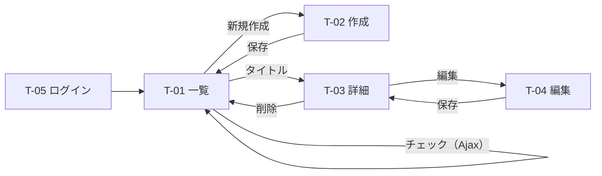

# 練習課題3：ToDoアプリのルーティング設計書

> 総合プロジェクトとは別の練習用の題材。ログインしたユーザーが自分の ToDo を管理するアプリ（Laravel + Breeze）。

## 1. 前提

| 項目 | 内容 |
|------|------|
| 利用者 | 登録ユーザーのみ。自分の ToDo だけ見られる・操作できる |
| ToDo の項目 | タイトル・メモ・期限・完了フラグ |
| 権限 | `TodoPolicy`：`todo.user_id === ログイン中のユーザーのid` のときだけ表示・編集・削除できる。違えば 403 |
| Ajax | 一覧のチェックボックスで「完了／未完了」を切り替える。ページは再読み込みせず JSON を受け取る |

## 2. 画面一覧

| ID | 画面名 | 内容 |
|----|--------|------|
| T-01 | ToDo 一覧 | 自分の ToDo を期限の近い順に表示。未完了／完了済み／すべてで絞り込み |
| T-02 | ToDo 作成 | タイトル・メモ・期限を入力 |
| T-03 | ToDo 詳細 | メモを含めて表示 |
| T-04 | ToDo 編集 | 作成と同じ項目を編集 |
| T-05 | 会員登録・ログイン | Breeze 標準 |



## 3. ルート一覧

`/todos` 以下はすべて `auth` ミドルウェアのグループに入れる。

| 画面ID | 画面・処理 | メソッド | URL | ルート名 | コントローラー@アクション | ログイン | 権限（Policy） | 返すもの |
|--------|-----------|---------|-----|---------|--------------------------|---------|---------------|---------|
| — | トップ | GET | `/` | `home` | （ルートで直接リダイレクト） | — | — | ログイン中なら `/todos`、未ログインなら `/login` へ |
| T-01 | 一覧 | GET | `/todos` | `todos.index` | `TodoController@index` | ○ | 自分の ToDo だけ取得 | 画面（`?status=open` / `done` で絞り込み） |
| T-02 | 作成画面 | GET | `/todos/create` | `todos.create` | `TodoController@create` | ○ | `TodoPolicy@create` | 画面 |
| — | 保存 | POST | `/todos` | `todos.store` | `TodoController@store` | ○ | `TodoPolicy@create` | 一覧へリダイレクト（「追加しました」を表示） |
| T-03 | 詳細 | GET | `/todos/{todo}` | `todos.show` | `TodoController@show` | ○ | `TodoPolicy@view` | 画面 |
| T-04 | 編集画面 | GET | `/todos/{todo}/edit` | `todos.edit` | `TodoController@edit` | ○ | `TodoPolicy@update` | 画面 |
| — | 更新 | PUT | `/todos/{todo}` | `todos.update` | `TodoController@update` | ○ | `TodoPolicy@update` | 詳細へリダイレクト |
| — | 削除 | DELETE | `/todos/{todo}` | `todos.destroy` | `TodoController@destroy` | ○ | `TodoPolicy@delete` | 一覧へリダイレクト |
| — | 完了・未完了の切り替え（Ajax） | PATCH | `/todos/{todo}/toggle` | `todos.toggle` | `TodoController@toggle` | ○ | `TodoPolicy@update` | **JSON** |
| T-05 | 会員登録・ログイン・ログアウト | GET/POST | `/register` `/login` `/logout` | `register` `login` `logout` | Breeze 標準 | — | — | 画面 ／ リダイレクト |

### routes/web.php（イメージ）

```php
Route::get('/', fn () => auth()->check()
    ? redirect()->route('todos.index')
    : redirect()->route('login'))->name('home');

Route::middleware('auth')->group(function () {
    Route::resource('todos', TodoController::class);
    Route::patch('todos/{todo}/toggle', [TodoController::class, 'toggle'])->name('todos.toggle');
});

require __DIR__.'/auth.php';
```

`Route::resource()` で一覧〜削除の7つのルートができる。切り替えは resource にない処理なので、別に1行追加する。

## 4. Ajax ルートの JSON

### PATCH /todos/{todo}/toggle

リクエスト（`fetch` で送る。ヘッダーに `X-CSRF-TOKEN` と `Accept: application/json`）
```json
{ "is_done": true }
```

レスポンス `200 OK`
```json
{
  "id": 5,
  "is_done": true,
  "done_at": "2026-10-19T21:30:00+09:00"
}
```

| 状態 | ステータス | 本文 |
|------|-----------|------|
| 他人の ToDo | `403 Forbidden` | `{"message": "This action is unauthorized."}` |
| 存在しない ToDo | `404 Not Found` | `{"message": "..."}` |
| `is_done` が true / false でない | `422 Unprocessable Content` | `{"message": "...", "errors": {"is_done": ["..."]}}` |
| 未ログイン | `401 Unauthorized` | `{"message": "Unauthenticated."}` |

コントローラーでは `return response()->json([...]);` で返す。`Accept: application/json` を付けておくと、認可エラーやバリデーションエラーも Laravel が自動で JSON にしてくれる。

## 5. 確認するテスト（Feature Test）

| テスト | 期待する結果 |
|--------|-------------|
| 未ログインで `/todos` | `/login` にリダイレクト |
| 自分の ToDo を toggle | 200 と `is_done: true`、DB が更新される |
| 他人の ToDo を toggle | 403、DB は変わらない |
| 他人の ToDo の編集画面 | 403 |
