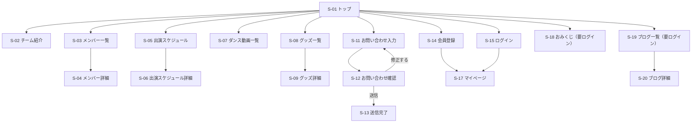
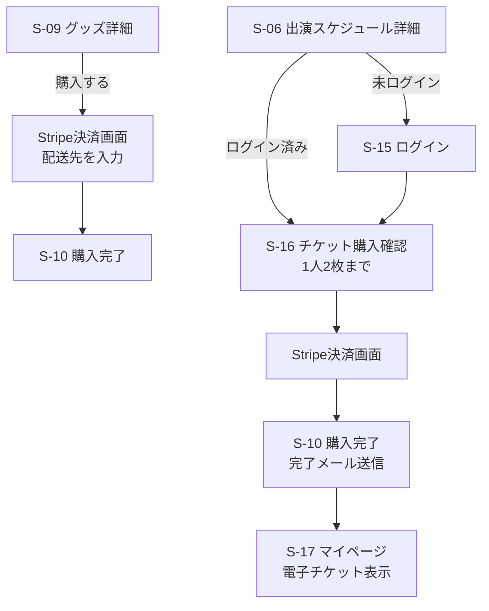
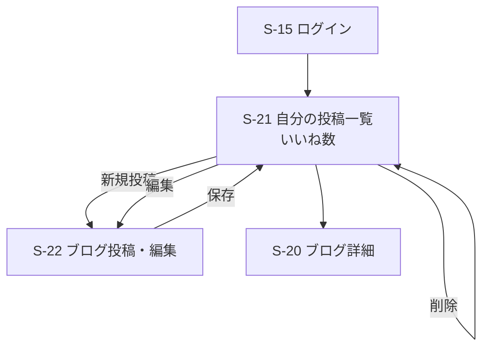
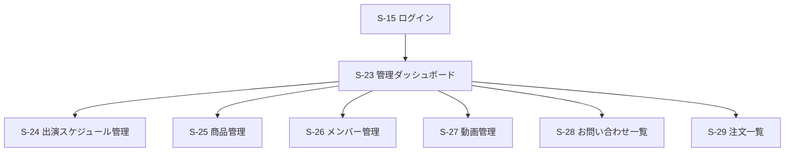

# 要件定義書：ヒップホップダンスチーム公式ファンサイト

> 関連ドキュメント（練習課題）
> - [ヒアリングシート](./practice/hearing-sheet.md)
> - [ユーザーストーリー](./practice/user-stories.md)
> - [要件の整理](./practice/requirements-sorting.md)

## 1. プロジェクト概要

### 1.1 プロジェクト名
BEAT CREW 公式ファンサイト（チーム名は仮）

### 1.2 背景・課題
> ヒアリング内容の詳細は[ヒアリングシート](./practice/hearing-sheet.md)を参照。
- イベント・出演情報が分かりにくく、いつどこでパフォーマンスが見られるのか把握しづらい
- グッズをどこで買えるのか分からない
- チケットの販売元が分かりづらく、どこで買えば正規のチケットなのか不安になる
- ライブがない日常の中で、チームを応援しながら自分も頑張れるきっかけがない
- 推しのダンサーの、ステージ以外の日常の姿を知る手段が少ない

### 1.3 目的・ゴール
チームに関する情報・購入・交流の窓口を公式サイトに一本化し、
ファンが「迷わず情報を見つけ、安心して買い、毎日チームを身近に感じられる」状態をつくる。

### 1.4 ターゲットユーザー
- メイン：チームのコアなファン（ライブに頻繁に足を運ぶ熱心なファン）
  - 未登録のファン：チーム情報・出演スケジュール・ダンス動画の閲覧、グッズの購入、お問い合わせができる
  - 会員のファン：上記に加え、チケットの購入、おみくじ、会員限定ブログの閲覧・いいね、購入履歴の確認ができる
- サブ：
  - ダンサー（チームメンバー）：会員限定ブログに日常の様子を投稿する
  - 運営スタッフ（管理者）：出演スケジュール・チケット・グッズ・メンバー情報の管理、お問い合わせ対応を行う

### 1.5 提供価値
- 出演スケジュールをカレンダーで一目で確認でき、次のパフォーマンスを見逃さない
- 会員登録なしでも、公式サイトから直接グッズを購入できる
- 公式のチケット販売窓口が明確になり、安心してチケットを購入できる
- 1日1回のおみくじで、ライブがない日もチームを応援しながら頑張るきっかけが持てる
- ダンサー本人が書く会員限定ブログで推しの日常を知り、いいねで気持ちを届けられる
- チーム紹介・メンバー一覧・ダンス動画で、チームの魅力をいつでも楽しめる

### 1.6 開発期間・体制
- 期間：Week 22〜24（3週間）
- 体制：個人開発

### 1.7 使用技術（想定）
| 分類 | 技術 |
|------|------|
| バックエンド | PHP / Laravel |
| 認証 | Laravel Breeze |
| データベース | MySQL |
| 開発環境 | Docker（Nginx / PHP-FPM / MySQL / phpMyAdmin） |
| 決済 | Stripe（テストモード） |
| 画像保存 | AWS S3 |
| インフラ | AWS（EC2 / RDS） |
| CI/CD | GitHub Actions |
| バージョン管理 | Git / GitHub |

---

## 2. ユーザーストーリー
> グッズ・チケット購入（ECサイト機能）の詳細なユーザーストーリーと受け入れ条件は[こちら](./practice/user-stories.md)を参照。

### 未登録のファン

- **US-01**：【未登録のファン】として、【出演スケジュールをカレンダーで確認】したい、なぜなら【次にいつどこでパフォーマンスが見られるのかを見逃したくない】から。
- **US-02**：【未登録のファン】として、【チーム紹介を見】たい、なぜなら【どんなチームなのかを知ったうえで応援したい】から。
- **US-03**：【未登録のファン】として、【メンバー一覧とプロフィールを見】たい、なぜなら【推しのダンサーのことをもっと知りたい】から。
- **US-04**：【未登録のファン】として、【チームのダンス動画を見】たい、なぜなら【ライブに行けない日もパフォーマンスを楽しみたい】から。
- **US-05**：【未登録のファン】として、【会員登録なしでグッズを購入】したい、なぜなら【公式のグッズを持って、応援をしたい】から。
- **US-06**：【未登録のファン】として、【お問い合わせフォームから連絡】したい、なぜなら【チームに質問や要望を直接伝えたい】から。
- **US-07**：【未登録のファン】として、【会員登録】したい、なぜなら【チケット購入や会員限定ブログなど、会員だけの楽しみを利用したい】から。

### 会員のファン

- **US-08**：【会員のファン】として、【公式サイトでチケットを購入】したい、なぜなら【いろんなサイトよりまとまっていた方が買いやすい】から。
- **US-09**：【会員のファン】として、【1日1回おみくじを引き】たい、なぜなら【ライブがない日も、チームを身近に感じながら毎日を頑張りたい】から。
- **US-10**：【会員のファン】として、【会員限定ブログを読み】たい、なぜなら【推しのダンサーのステージ以外の日常を知りたい】から。
- **US-11**：【会員のファン】として、【ブログにいいねをし】たい、なぜなら【応援している気持ちをダンサーに直接届けたい】から。
- **US-12**：【会員のファン】として、【自分の購入履歴を確認】したい、なぜなら【いつ何を買ったのかを把握しておきたい】から。

### ダンサー

- **US-13**：【ダンサー】として、【会員限定ブログを投稿】したい、なぜなら【ステージ以外の自分の姿を伝えて、ファンとの距離を縮めたい】から。
- **US-14**：【ダンサー】として、【自分の投稿を編集・削除】したい、なぜなら【間違いを直したり、載せたくなくなった投稿を取り下げたい】から。
- **US-15**：【ダンサー】として、【投稿についたいいね数を確認】したい、なぜなら【ファンがどんな投稿を喜んでくれたのかを知り、次の発信に活かしたい】から。

### 運営スタッフ（管理者）

- **US-16**：【管理者】として、【出演スケジュールを登録・編集・削除】したい、なぜなら【最新の出演情報を正確にファンに届けたい】から。
- **US-17**：【管理者】として、【チケット・グッズの価格や在庫を管理】したい、なぜなら【売り切れや価格変更をすぐに反映し、ファンに誤った情報を見せたくない】から。
- **US-18**：【管理者】として、【メンバー情報を登録・編集・削除】したい、なぜなら【メンバーの加入・脱退やプロフィールの変更にすぐ対応したい】から。
- **US-19**：【管理者】として、【YouTubeのダンス動画を登録・削除】したい、なぜなら【新しいパフォーマンスをすぐにファンに公開したい】から。
- **US-20**：【管理者】として、【届いたお問い合わせを一覧で確認】したい、なぜなら【ファンからの連絡に漏れなく対応したい】から。
- **US-21**：【管理者】として、【チケット・グッズの注文を一覧で確認】したい、なぜなら【グッズの発送やチケットの販売状況を把握したい】から。

---

## 3. 機能要件一覧
> 曖昧な要望から各要件を決めた過程は[要件整理](./practice/requirements-sorting.md)を参照。

### 優先度の考え方
| 優先度 | 意味 |
|--------|------|
| 必須 | これがないとサービスとして成り立たない。最初に作る |
| 推奨 | あるとファンの満足度が上がる。必須が終わったら作る |
| 任意 | 余裕があれば作る |

### 3.1 認証・会員

| ID | 機能名 | 概要 | 利用者 | 対応US | 優先度 |
|----|--------|------|--------|--------|--------|
| F-01 | 会員登録 | 名前・メールアドレス・パスワードで会員登録する | 未登録のファン | US-07 | 必須 |
| F-02 | ログイン・ログアウト | 登録したメールアドレスとパスワードでログインする | 会員・ダンサー・管理者 | US-07 | 必須 |
| F-03 | 権限管理 | ファン・ダンサー・管理者で使える機能を分ける | 全員 | US-13〜21 | 必須 |

### 3.2 チーム情報

| ID | 機能名 | 概要 | 利用者 | 対応US | 優先度 |
|----|--------|------|--------|--------|--------|
| F-04 | トップページ | 直近の出演予定・新着動画・新着グッズを表示する | 全員 | US-01, 04, 05 | 必須 |
| F-05 | チーム紹介 | チームのコンセプト・結成の経緯などを表示する | 全員 | US-02 | 必須 |
| F-06 | メンバー一覧・詳細 | メンバーの一覧と、各メンバーのプロフィールを表示する | 全員 | US-03 | 必須 |
| F-07 | 出演スケジュール（カレンダー） | 出演予定を月ごとのカレンダーで表示する | 全員 | US-01 | 必須 |
| F-08 | 出演スケジュール詳細 | 日時・会場・内容を表示し、チケット購入へ案内する | 全員 | US-01, 08 | 必須 |
| F-09 | ダンス動画一覧 | YouTube動画を埋め込みで一覧表示する | 全員 | US-04 | 必須 |
| F-10 | お問い合わせ | フォームから名前・メールアドレス・内容を送信する | 全員 | US-06 | 必須 |

### 3.3 購入

| ID | 機能名 | 概要 | 利用者 | 対応US | 優先度 |
|----|--------|------|--------|--------|--------|
| F-11 | グッズ一覧・詳細 | グッズの画像・価格・在庫状況を表示する | 全員 | US-05 | 必須 |
| F-12 | グッズ購入 | 会員登録なしでもStripeで決済できる。配送先を入力し、購入後に在庫を減らす。購入完了後、入力したメールアドレスに完了メールを送信する | 全員 | US-05 | 必須 |
| F-13 | カート | 複数のグッズをまとめて購入する | 全員 | US-05 | 任意 |
| F-14 | チケット購入 | 会員のみ、出演スケジュールごとのチケットをStripeで購入する。1公演につき1人2枚まで。残り枚数を管理する。購入完了後に完了メールを送信し、マイページに電子チケット（購入番号・公演日時・会場）を表示する | 会員 | US-08 | 必須 |
| F-15 | 購入履歴 | 自分が購入したチケット・グッズを一覧で確認する | 会員 | US-12 | 推奨 |

### 3.4 会員限定コンテンツ

| ID | 機能名 | 概要 | 利用者 | 対応US | 優先度 |
|----|--------|------|--------|--------|--------|
| F-16 | おみくじ | 1日1回おみくじを引ける。同じ日に2回目は引けない | 会員 | US-09 | 必須 |
| F-17 | 会員限定ブログ閲覧 | ダンサーのブログを一覧・詳細で読む。未ログイン時はログインへ案内する | 会員 | US-10 | 必須 |
| F-18 | いいね | ブログにいいねを付ける・取り消す（1記事につき1人1回） | 会員 | US-11 | 推奨 |

### 3.5 ダンサー向け機能

| ID | 機能名 | 概要 | 利用者 | 対応US | 優先度 |
|----|--------|------|--------|--------|--------|
| F-19 | ブログ投稿 | タイトル・本文・画像（S3に保存）でブログを投稿する | ダンサー | US-13 | 必須 |
| F-20 | ブログ編集・削除 | 自分の投稿のみ編集・削除できる | ダンサー | US-14 | 必須 |
| F-21 | いいね数の確認 | 自分の投稿ごとのいいね数を確認する | ダンサー | US-15 | 推奨 |

### 3.6 管理者向け機能

| ID | 機能名 | 概要 | 利用者 | 対応US | 優先度 |
|----|--------|------|--------|--------|--------|
| F-22 | 出演スケジュール管理 | 出演予定の登録・編集・削除 | 管理者 | US-16 | 必須 |
| F-23 | 商品管理 | チケット・グッズの登録・編集・削除、価格・在庫の変更 | 管理者 | US-17 | 必須 |
| F-24 | メンバー管理 | メンバー情報の登録・編集・削除 | 管理者 | US-18 | 必須 |
| F-25 | ダンサー用アカウント発行 | 管理画面からダンサーのログイン用アカウントを発行する（初期はシーダーで作成） | 管理者 | US-18 | 任意 |
| F-26 | 動画管理 | YouTube動画のURLを登録・削除する | 管理者 | US-19 | 推奨 |
| F-27 | お問い合わせ一覧 | 届いたお問い合わせを一覧・詳細で確認する | 管理者 | US-20 | 推奨 |
| F-28 | 注文一覧 | チケット・グッズの注文を一覧で確認する | 管理者 | US-21 | 推奨 |

---

## 4. 非機能要件

### 4.1 性能
| ID | 項目 | 内容 |
|----|------|------|
| NF-01 | 表示速度 | 主要ページ（トップ・スケジュール・グッズ一覧）を3秒以内に表示する |
| NF-02 | Lighthouseスコア | 主要ページのPerformanceスコア（モバイル）80以上を目標とする |
| NF-03 | DBアクセスの効率化 | 一覧ページでN+1問題を発生させない（Eager Loadingを使用） |
| NF-04 | 画像の軽量化 | グッズ・ブログの画像はS3に保存し、適切なサイズに圧縮して表示する |

### 4.2 セキュリティ
| ID | 項目 | 内容 |
|----|------|------|
| NF-05 | 通信の暗号化 | 本番環境は全ページHTTPSで通信する |
| NF-06 | パスワード保護 | パスワードはハッシュ化して保存する |
| NF-07 | 一般的な攻撃への対策 | CSRF・XSS・SQLインジェクション対策を行う（Laravel標準機能を使用） |
| NF-08 | 権限によるアクセス制御 | ファン・ダンサー・管理者で、利用できない画面にはアクセスできないようにする。ダンサーは自分のブログのみ編集・削除できる |
| NF-09 | 決済情報の保護 | クレジットカード情報は自サーバーに保存せず、Stripeで処理する |
| NF-10 | 秘密情報の管理 | APIキーやパスワードは.envで管理し、GitHubに含めない |
| NF-11 | 在庫の整合性 | 同時に購入されても、チケット・グッズの在庫がマイナスにならないようにする |

### 4.3 使いやすさ・対応環境
| ID | 項目 | 内容 |
|----|------|------|
| NF-12 | スマートフォン対応 | ファンは主にスマートフォンで閲覧する前提とし、スマホ画面を基準に設計する（モバイルファースト）。PCでも崩れずに表示できるようにする |
| NF-13 | 対応ブラウザ | Google Chrome・Safari・Microsoft Edgeの最新版 |
| NF-14 | 分かりやすい操作 | ヘッダーメニューから主要ページへ1クリックで移動できる |
| NF-15 | エラー表示 | 入力ミスがあった場合は、どこが間違っているか日本語で分かりやすく表示する |

### 4.4 運用
| ID | 項目 | 内容 |
|----|------|------|
| NF-16 | 稼働環境 | AWS（EC2・RDS）上で動かし、24時間閲覧できるようにする |
| NF-17 | メール送信 | 開発環境ではメールを実際に送らず、確認用ツール（Mailpitなど）で内容を確認する |
| NF-18 | ログ | エラーが起きた際に原因を調べられるよう、エラーログを記録する |

### 4.5 保守性・品質
| ID | 項目 | 内容 |
|----|------|------|
| NF-19 | テスト | 主要機能にFeature Testを作成し、カバレッジ70%以上を目標とする |
| NF-20 | 自動チェック | GitHub Actionsで、push時にLintとテストを自動実行する |
| NF-21 | コード設計 | Service層・Repository層に処理を分け、コントローラーを薄く保つ |

---

## 5. 画面遷移図

> 今週は簡易版。Week 19でFigmaを使って清書する。

### 5.1 画面一覧

| ID | 画面名 | 利用者 | 対応機能 |
|----|--------|--------|----------|
| S-01 | トップ | 全員 | F-04 |
| S-02 | チーム紹介 | 全員 | F-05 |
| S-03 | メンバー一覧 | 全員 | F-06 |
| S-04 | メンバー詳細 | 全員 | F-06 |
| S-05 | 出演スケジュール（カレンダー） | 全員 | F-07 |
| S-06 | 出演スケジュール詳細 | 全員 | F-08 |
| S-07 | ダンス動画一覧 | 全員 | F-09 |
| S-08 | グッズ一覧 | 全員 | F-11 |
| S-09 | グッズ詳細 | 全員 | F-11 |
| S-10 | 購入完了 | 全員 | F-12, F-14 |
| S-11 | お問い合わせ入力 | 全員 | F-10 |
| S-12 | お問い合わせ確認 | 全員 | F-10 |
| S-13 | お問い合わせ送信完了 | 全員 | F-10 |
| S-14 | 会員登録 | 未登録のファン | F-01 |
| S-15 | ログイン | 会員・ダンサー・管理者 | F-02 |
| S-16 | チケット購入確認（枚数選択） | 会員 | F-14 |
| S-17 | マイページ（電子チケット・購入履歴） | 会員 | F-14, F-15 |
| S-18 | おみくじ | 会員 | F-16 |
| S-19 | ブログ一覧 | 会員 | F-17 |
| S-20 | ブログ詳細（いいね） | 会員 | F-17, F-18 |
| S-21 | 自分の投稿一覧（いいね数） | ダンサー | F-20, F-21 |
| S-22 | ブログ投稿・編集 | ダンサー | F-19, F-20 |
| S-23 | 管理ダッシュボード | 管理者 | — |
| S-24 | 出演スケジュール管理 | 管理者 | F-22 |
| S-25 | 商品管理 | 管理者 | F-23 |
| S-26 | メンバー管理 | 管理者 | F-24, F-25 |
| S-27 | 動画管理 | 管理者 | F-26 |
| S-28 | お問い合わせ一覧 | 管理者 | F-27 |
| S-29 | 注文一覧 | 管理者 | F-28 |

※ Stripeの決済画面は外部サービスのため、画面一覧には含めない。

### 5.2 ファン向け画面

ヘッダーメニューから、各画面へ1クリックで移動できる（NF-14）。

### 5.3 購入の流れ

### 5.4 ダンサー向け画面

### 5.5 管理者向け画面

---

## 6. 制約条件

### 6.1 期間・体制
| ID | 項目 | 内容 |
|----|------|------|
| C-01 | 開発期間 | Week 22〜24の3週間で開発する。優先度「必須」の機能を最優先で完成させる |
| C-02 | 開発体制 | 個人開発（設計・実装・テスト・デプロイをすべて1人で行う） |

### 6.2 予算
| ID | 項目 | 内容 |
|----|------|------|
| C-03 | 費用 | 開発・運用費用は原則0円とし、AWSは無料利用枠の範囲内で利用する |

### 6.3 技術
| ID | 項目 | 内容 |
|----|------|------|
| C-04 | 使用技術 | 1.7に記載した、これまでの課題で学んだ技術（Laravel / Docker / AWS など）を使用する |
| C-05 | 決済 | Stripeはテストモードで利用し、実際の決済は行わない |
| C-06 | 動画 | ダンス動画はサーバーに保存せず、YouTubeの埋め込みで表示する |
| C-07 | メール | 開発環境では確認用ツール（Mailpitなど）を使い、実際のメールは送信しない |

### 6.4 コンテンツ・運用
| ID | 項目 | 内容 |
|----|------|------|
| C-08 | 架空のチーム | チーム・メンバーは架空のものとし、実在の人物・団体の名前や写真は使用しない |
| C-09 | 素材 | 画像は自作またはフリー素材を使用し、著作権に配慮する |
| C-10 | グッズ配送 | グッズの実際の配送は行わない（購入・在庫管理までを対象とする） |
| C-11 | 対応範囲 | Webサイトのみを対象とし、スマートフォンアプリは開発しない |

### 6.5 その他
| ID | 項目 | 内容 |
|----|------|------|
| C-12 | 画面遷移図 | 本書の画面遷移図は簡易版とし、Week 19でFigmaを使って清書する |