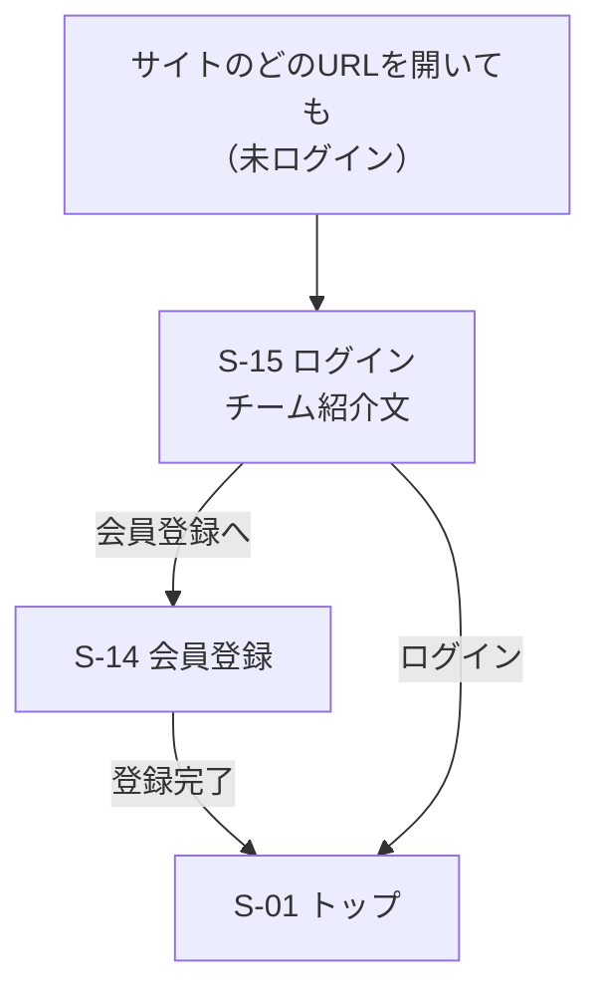
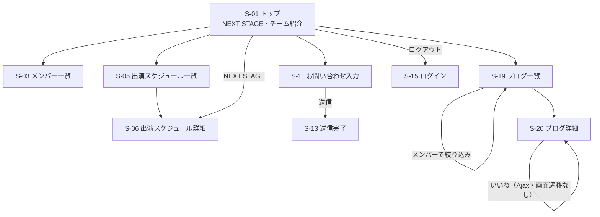
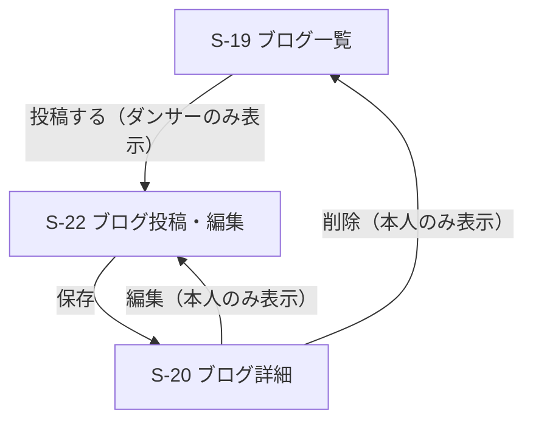

# 要件定義書：ヒップホップダンスチーム公式ファンサイト（Week 21 確定版）

> 関連ドキュメント（練習課題）
> - [ヒアリングシート](./practice/hearing-sheet.md)
> - [ユーザーストーリー](./practice/user-stories.md)
> - [要件の整理](./practice/requirements-sorting.md)

## 1. プロジェクト概要

### 1.1 プロジェクト名
BEAT CREW ファンクラブ会員サイト（チーム名は仮）

### 1.2 背景・課題
> ヒアリング内容の詳細は[ヒアリングシート](./practice/hearing-sheet.md)を参照。
- イベント・出演情報が分かりにくく、いつどこでパフォーマンスが見られるのか把握しづらい
- グッズをどこで買えるのか分からない
- チケットの販売元が分かりづらく、どこで買えば正規のチケットなのか不安になる
- ライブがない日常の中で、チームを応援しながら自分も頑張れるきっかけがない
- 推しのダンサーの、ステージ以外の日常の姿を知る手段が少ない

### 1.3 目的・ゴール
チームの情報とダンサーの発信を、会員限定のサイトに一本化する。
ファンが「迷わず出演情報を見つけ、推しの日常に触れ、いいねで応援の気持ちを届けられる」状態をつくる。

今回の開発（Week 22〜24）では、情報の窓口とダンサーのブログに絞って作る。
グッズ・チケットの購入は、次の段階で追加する（3章 MVP、5章 機能要件を参照）。

### 1.4 ターゲットユーザー
- メイン：チームのコアなファン（ライブに頻繁に足を運ぶ熱心なファン）
  - 未登録の人：ログイン画面でチームの紹介を見て、会員登録・ログインができる
  - 会員のファン：トップ・メンバー一覧・出演スケジュールの閲覧、お問い合わせ、ダンサーのブログの閲覧・いいねができる
- サブ：
  - ダンサー（チームメンバー）：会員のファンと同じ機能に加えて、ブログに日常の様子を投稿・編集・削除できる
  - 運営スタッフ（管理者）：今回は作らない。出演スケジュール・メンバー情報などは Seeder で登録する

### 1.5 提供価値
- サイト全体を会員限定にすることで、ファンクラブに入っている特別感を持てる
- トップで直近の出演予定とチーム紹介をまとめて確認でき、次のパフォーマンスを見逃さない
- ダンサー本人が書くブログで推しの日常を知り、いいねで気持ちを届けられる
- メンバーごとにブログを絞り込めるので、推しの記事だけを読める
- 公式のお問い合わせ窓口から、チームに直接連絡できる

### 1.6 開発期間・体制
- 期間：Week 22〜24（3スプリント、合計26時間）
- 体制：個人開発

### 1.7 使用技術
| 分類 | 技術 |
|------|------|
| バックエンド | PHP / Laravel（Blade の Web アプリ、`routes/web.php`） |
| 認証 | Laravel Breeze |
| 非同期通信 | JavaScript（fetch API） |
| データベース | MySQL |
| 開発環境 | Docker（Nginx / PHP-FPM / MySQL / phpMyAdmin） |
| 画像保存 | ローカル（storage/app/public）。S3 は発展課題（任意） |
| インフラ | AWS（EC2 / RDS） |
| CI/CD | GitHub Actions |
| バージョン管理 | Git / GitHub |

※ Stripe（決済）は、グッズ・チケット購入を作る段階で追加する。今回は使わない。

### 1.8 コース必須機能との対応

| 必須機能 | 担当する機能 |
|---------|-------------|
| ログイン・ログアウト（Breeze） | F-01, F-02, F-29 |
| 主要なデータの CRUD | F-17, F-19, F-20（ブログの作成・一覧・詳細・編集・削除） |
| 自分のデータだけ編集・削除できる権限管理（Policy） | F-20（PostPolicy） |
| 検索または絞り込み | F-32（ブログをメンバーで絞り込み） |
| 画像アップロード | F-19（ブログの写真） |
| ページを再読み込みしない操作（Ajax） | F-18（いいね） |

---

## 2. ペルソナ

### 2.1 ペルソナ1：会員のファン
| 項目 | 内容 |
|------|------|
| 名前・年齢 | ゆい（24歳） |
| 職業 | 会社員 |
| BEAT CREW との関わり | 2年前にイベントでステージを観て好きになった。月1回はライブに行く |
| 推し | ブレイク担当のメンバー |
| よく使う端末 | スマートフォン（通勤中・寝る前に見る） |
| 困りごと | 出演情報がSNSに流れてしまい、見逃すことがある。推しのステージ以外の姿をもっと知りたい |
| このサイトでしたいこと | 次の出演予定を確認する。推しのブログだけを読み、いいねで応援する |

### 2.2 ペルソナ2：ダンサー
| 項目 | 内容 |
|------|------|
| 名前・年齢 | RYO（27歳） |
| 役割 | BEAT CREW のメンバー（ブレイク担当） |
| よく使う端末 | スマートフォン（練習の合間に投稿する） |
| 困りごと | SNSでは投稿がすぐ流れてしまい、ファンに届いているか分からない |
| このサイトでしたいこと | 練習やステージの裏側を写真付きで伝え、いいねの数でファンの反応を知る |

※ チーム・メンバーは架空のもの（C-08）。

---

## 3. MVP（Week 22〜23 で実装する範囲）

Must の機能のうち、F-18（いいね）を除くすべてを Week 22〜23 で実装する。
F-18 は Week 24 で実装し、テスト・デプロイと合わせて仕上げる。

| スプリント | 実装する機能 |
|-----------|-------------|
| Week 22 | 環境構築、F-01, F-02, F-29（ログイン必須化）, F-03（ロール）, F-04, F-05, F-06, F-30, F-08 |
| Week 23 | F-17, F-19, F-20, F-32（ブログ・Policy・画像・絞り込み）, F-10（お問い合わせ） |
| Week 24 | F-18（いいね・Ajax）、テスト、デプロイ |

詳細は [スプリント計画](./sprint-plan.md) を参照。

---

## 4. ユーザーストーリー
> グッズ・チケット購入（ECサイト機能）の詳細なユーザーストーリーと受け入れ条件は[こちら](./practice/user-stories.md)を参照。

### 未登録の人

- **US-07**：【未登録の人】として、【会員登録】したい、なぜなら【会員限定のサイトに入って、チームの情報やブログを楽しみたい】から。（Must）
- **US-22**：【未登録の人】として、【ログイン画面でチームの紹介を見】たい、なぜなら【どんなチームなのかを知ってから会員登録したい】から。（Must）

### 会員のファン

- **US-01**：【会員のファン】として、【出演スケジュールを確認】したい、なぜなら【次にいつどこでパフォーマンスが見られるのかを見逃したくない】から。（Must：一覧と詳細。カレンダー表示は Could）
- **US-02**：【会員のファン】として、【チーム紹介を見】たい、なぜなら【どんなチームなのかを知ったうえで応援したい】から。（Must：トップの1セクションとして表示）
- **US-03**：【会員のファン】として、【メンバー一覧を見】たい、なぜなら【推しのダンサーのことをもっと知りたい】から。（Must：一覧のみ。詳細は Should）
- **US-06**：【会員のファン】として、【お問い合わせフォームから連絡】したい、なぜなら【チームに質問や要望を直接伝えたい】から。（Must）
- **US-10**：【会員のファン】として、【ダンサーのブログを読み】たい、なぜなら【推しのダンサーのステージ以外の日常を知りたい】から。（Must）
- **US-23**：【会員のファン】として、【ブログをメンバーごとに絞り込み】たい、なぜなら【推しのダンサーの記事だけを読みたい】から。（Must）
- **US-11**：【会員のファン】として、【ページを再読み込みせずにブログにいいねをし】たい、なぜなら【応援している気持ちを気軽にダンサーに届けたい】から。（Must）
- **US-24**：【会員のファン】として、【ログアウト】したい、なぜなら【共有の端末でも安心して使いたい】から。（Must）
- **US-04**：【会員のファン】として、【チームのダンス動画を見】たい、なぜなら【ライブに行けない日もパフォーマンスを楽しみたい】から。（Should）
- **US-05**：【会員のファン】として、【グッズをカテゴリで絞り込んで見】たい、なぜなら【欲しいグッズを探しやすくしたい】から。（Should：一覧・絞り込み。購入は Could）
- **US-08**：【会員のファン】として、【公式サイトでチケットを購入】したい、なぜなら【いろんなサイトよりまとまっていた方が買いやすい】から。（Could）
- **US-09**：【会員のファン】として、【1日1回おみくじを引き】たい、なぜなら【ライブがない日も、チームを身近に感じながら毎日を頑張りたい】から。（Could）
- **US-12**：【会員のファン】として、【自分の購入履歴を確認】したい、なぜなら【いつ何を買ったのかを把握しておきたい】から。（Could）

### ダンサー

- **US-13**：【ダンサー】として、【写真付きでブログを投稿】したい、なぜなら【ステージ以外の自分の姿を伝えて、ファンとの距離を縮めたい】から。（Must）
- **US-14**：【ダンサー】として、【自分の投稿を編集・削除】したい、なぜなら【間違いを直したり、載せたくなくなった投稿を取り下げたい】から。（Must）
- **US-25**：【ダンサー】として、【ほかのダンサーの投稿は編集・削除できないように】したい、なぜなら【投稿は書いた本人のものとして守られていてほしい】から。（Must）
- **US-15**：【ダンサー】として、【投稿についたいいね数を確認】したい、なぜなら【ファンがどんな投稿を喜んでくれたのかを知り、次の発信に活かしたい】から。（Must：ブログ詳細でいいね数を表示。自分の投稿一覧での確認は Should）

### 運営スタッフ（管理者）

今回は管理画面を作らず、データは Seeder で登録する。以下はすべて Could。

- **US-16**：【管理者】として、【出演スケジュールを登録・編集・削除】したい、なぜなら【最新の出演情報を正確にファンに届けたい】から。（Could）
- **US-17**：【管理者】として、【チケット・グッズの価格や在庫を管理】したい、なぜなら【売り切れや価格変更をすぐに反映し、ファンに誤った情報を見せたくない】から。（Could）
- **US-18**：【管理者】として、【メンバー情報を登録・編集・削除】したい、なぜなら【メンバーの加入・脱退やプロフィールの変更にすぐ対応したい】から。（Could）
- **US-19**：【管理者】として、【YouTubeのダンス動画を登録・削除】したい、なぜなら【新しいパフォーマンスをすぐにファンに公開したい】から。（Could）
- **US-20**：【管理者】として、【届いたお問い合わせを一覧で確認】したい、なぜなら【ファンからの連絡に漏れなく対応したい】から。（Could）
- **US-21**：【管理者】として、【チケット・グッズの注文を一覧で確認】したい、なぜなら【グッズの発送やチケットの販売状況を把握したい】から。（Could）

---

## 5. 機能要件一覧
> 曖昧な要望から各要件を決めた過程は[要件整理](./practice/requirements-sorting.md)を参照。

### 優先度の考え方
| 優先度 | 意味 |
|--------|------|
| Must（必須） | これがないとサービスとして成り立たない。コースの必須機能もすべてここに入れる。今回（Week 22〜24）必ず作る |
| Should（推奨） | あるとファンの満足度が上がる。Must が終わって時間があれば作る |
| Could（任意） | 今回は作らない。次の段階で検討する |

### 5.1 認証・会員

| ID | 機能名 | 概要 | 利用者 | 対応US | 優先度 |
|----|--------|------|--------|--------|--------|
| F-01 | 会員登録 | 名前・メールアドレス・パスワードで会員登録する（Breeze）。登録したユーザーは「ファン」になる | 未登録の人 | US-07 | Must |
| F-02 | ログイン・ログアウト | 登録したメールアドレスとパスワードでログイン・ログアウトする（Breeze） | 会員・ダンサー | US-07, 24 | Must |
| F-29 | ログイン必須化 | 会員登録・ログイン以外の全ページをログイン必須にする。ログイン画面にチームの紹介文を表示する | 全員 | US-22 | Must |
| F-03 | 権限管理 | ファン・ダンサーの2つのロールで使える機能を分ける。ダンサーのアカウントは Seeder で作成する | 全員 | US-13, 25 | Must |

### 5.2 チーム情報

| ID | 機能名 | 概要 | 利用者 | 対応US | 優先度 |
|----|--------|------|--------|--------|--------|
| F-04 | トップページ | 直近の出演予定（NEXT STAGE）とチーム紹介を表示する | 会員 | US-01, 02 | Must |
| F-05 | チーム紹介 | チームのコンセプト・結成の経緯などを、トップの1セクションとして表示する | 会員 | US-02 | Must |
| F-06 | メンバー一覧 | メンバーの写真・名前・担当を一覧で表示する | 会員 | US-03 | Must |
| F-31 | メンバー詳細 | 各メンバーのプロフィールと、そのメンバーのブログへのリンクを表示する | 会員 | US-03 | Should |
| F-30 | 出演スケジュール一覧 | 出演予定を日付順のリストで表示する | 会員 | US-01 | Must |
| F-07 | 出演スケジュール（カレンダー） | 出演予定を月ごとのカレンダーで表示する | 会員 | US-01 | Could |
| F-08 | 出演スケジュール詳細 | 日時・会場・メンバーからのコメントを表示する | 会員 | US-01 | Must |
| F-09 | ダンス動画一覧 | YouTube動画を埋め込みで一覧表示する | 会員 | US-04 | Should |
| F-10 | お問い合わせ | フォームから名前・メールアドレス・内容を送信し、DBに保存して完了画面を表示する。メールは送信しない。確認画面は Should | 会員 | US-06 | Must |

### 5.3 購入

| ID | 機能名 | 概要 | 利用者 | 対応US | 優先度 |
|----|--------|------|--------|--------|--------|
| F-11 | グッズ一覧・詳細 | グッズの画像・価格・在庫状況を表示する。カテゴリで絞り込める | 会員 | US-05 | Should |
| F-12 | グッズ購入 | Stripeで決済する。配送先を入力し、購入後に在庫を減らす。購入完了後に完了メールを送信する | 会員 | US-05 | Could |
| F-13 | カート | 複数のグッズをまとめて購入する | 会員 | US-05 | Could |
| F-14 | チケット購入 | 出演スケジュールごとのチケットをStripeで購入する。1公演につき1人2枚まで。残り枚数を管理する。購入完了後に完了メールを送信し、マイページに電子チケットを表示する | 会員 | US-08 | Could |
| F-15 | 購入履歴 | 自分が購入したチケット・グッズを一覧で確認する | 会員 | US-12 | Could |

### 5.4 会員限定コンテンツ

| ID | 機能名 | 概要 | 利用者 | 対応US | 優先度 |
|----|--------|------|--------|--------|--------|
| F-17 | ブログ閲覧 | ダンサーのブログを一覧（新しい順・10件ずつ）と詳細で読む | 会員・ダンサー | US-10 | Must |
| F-32 | メンバーで絞り込み | ブログ一覧を、書いたダンサーで絞り込む | 会員・ダンサー | US-23 | Must |
| F-18 | いいね | ブログ詳細で、いいねの登録・取り消しをページを再読み込みせずに行う（Ajax）。1記事につき1人1回 | 会員・ダンサー | US-11 | Must |
| F-16 | おみくじ | 1日1回おみくじを引ける。同じ日に2回目は引けない | 会員 | US-09 | Could |

### 5.5 ダンサー向け機能

| ID | 機能名 | 概要 | 利用者 | 対応US | 優先度 |
|----|--------|------|--------|--------|--------|
| F-19 | ブログ投稿 | タイトル・本文・画像1枚でブログを投稿する。画像はローカル（storage/app/public）に保存する。ダンサーだけが投稿できる | ダンサー | US-13 | Must |
| F-20 | ブログ編集・削除 | 自分の投稿のみ編集・削除できる（Policy）。ほかの人の投稿では編集・削除ボタンを表示せず、URLを直接開いても 403 にする | ダンサー | US-14, 25 | Must |
| F-21 | 自分の投稿一覧 | 自分の投稿といいね数を一覧で確認する（いいね数はブログ詳細でも確認できる） | ダンサー | US-15 | Should |

### 5.6 管理者向け機能

今回は管理画面を作らない。出演スケジュール・メンバー情報・ダンサーのアカウントは Seeder で登録する。

| ID | 機能名 | 概要 | 利用者 | 対応US | 優先度 |
|----|--------|------|--------|--------|--------|
| F-22 | 出演スケジュール管理 | 出演予定の登録・編集・削除 | 管理者 | US-16 | Could |
| F-23 | 商品管理 | チケット・グッズの登録・編集・削除、価格・在庫の変更 | 管理者 | US-17 | Could |
| F-24 | メンバー管理 | メンバー情報の登録・編集・削除 | 管理者 | US-18 | Could |
| F-25 | ダンサー用アカウント発行 | 管理画面からダンサーのログイン用アカウントを発行する | 管理者 | US-18 | Could |
| F-26 | 動画管理 | YouTube動画のURLを登録・削除する | 管理者 | US-19 | Could |
| F-27 | お問い合わせ一覧 | 届いたお問い合わせを一覧・詳細で確認する | 管理者 | US-20 | Could |
| F-28 | 注文一覧 | チケット・グッズの注文を一覧で確認する | 管理者 | US-21 | Could |
| F-33 | 画像のS3保存 | ブログ・グッズの画像を AWS S3 に保存する | 管理者 | US-13 | Could |

---

## 6. 非機能要件

### 6.1 性能
| ID | 項目 | 内容 |
|----|------|------|
| NF-01 | 表示速度 | 主要ページ（トップ・出演スケジュール・ブログ一覧）を3秒以内に表示する |
| NF-02 | Lighthouseスコア | 主要ページのPerformanceスコア（モバイル）80以上を目標とする |
| NF-03 | DBアクセスの効率化 | 一覧ページでN+1問題を発生させない（ブログ一覧では、書いた人といいね数を Eager Loading で取得する） |
| NF-04 | 一覧のページ分け | ブログ一覧は10件ずつページ分けして表示する |

### 6.2 セキュリティ
| ID | 項目 | 内容 |
|----|------|------|
| NF-05 | 通信の暗号化 | 本番環境は全ページHTTPSで通信する |
| NF-06 | パスワード保護 | パスワードはハッシュ化して保存する |
| NF-07 | 一般的な攻撃への対策 | CSRF・XSS・SQLインジェクション対策を行う（Laravel標準機能を使用）。Ajax のリクエストにも CSRF トークンを付ける |
| NF-08 | 権限によるアクセス制御 | 未ログインでは会員登録・ログイン以外の画面に入れない。ブログの投稿はダンサーのみ、編集・削除は投稿した本人のみ（Policy）。権限がない場合は 403 を返す |
| NF-09 | 入力チェック | 入力値は FormRequest でバリデーションする |
| NF-10 | 秘密情報の管理 | APIキーやパスワードは.envで管理し、GitHubに含めない |
| NF-11 | 画像アップロードの制限 | 画像は jpg・png・webp のみ、1枚2MBまでとする |

### 6.3 使いやすさ・対応環境
| ID | 項目 | 内容 |
|----|------|------|
| NF-12 | スマートフォン対応 | ファンは主にスマートフォンで閲覧する前提とし、スマホ画面を基準に設計する（モバイルファースト）。PCでも崩れずに表示できるようにする |
| NF-13 | 対応ブラウザ | Google Chrome・Safari・Microsoft Edgeの最新版 |
| NF-14 | 分かりやすい操作 | ヘッダーメニューから主要ページへ1クリックで移動できる |
| NF-15 | エラー表示 | 入力ミスがあった場合は、どこが間違っているか日本語で分かりやすく表示する |
| NF-22 | 権限に合わせた表示 | 使えないボタン（ファンには「投稿する」、他人の投稿には「編集」「削除」）は表示しない |

### 6.4 運用
| ID | 項目 | 内容 |
|----|------|------|
| NF-16 | 稼働環境 | AWS（EC2・RDS）上で動かし、24時間閲覧できるようにする |
| NF-17 | 画像の保存 | 画像は storage/app/public に保存し、`php artisan storage:link` で公開する。本番環境でも同じ構成にする |
| NF-18 | ログ | エラーが起きた際に原因を調べられるよう、エラーログを記録する |

### 6.5 保守性・品質
| ID | 項目 | 内容 |
|----|------|------|
| NF-19 | テスト | Feature Test で、ログイン必須化・Policy（他人の投稿を編集・削除できないこと）・いいねを確認する |
| NF-20 | 自動チェック | GitHub Actionsで、push時にテストを自動実行する |
| NF-21 | コード設計 | 入力チェックは FormRequest、権限は Policy に分け、コントローラーを薄く保つ |

---

## 7. 画面遷移図

> Figma版は [画面設計](./01_screen-design/figma.md) を参照。

### 7.1 画面一覧

#### 今回作る画面（Must）

| ID | 画面名 | 利用者 | 対応機能 |
|----|--------|--------|----------|
| S-14 | 会員登録 | 未登録の人 | F-01 |
| S-15 | ログイン（チーム紹介文つき） | 全員 | F-02, F-29 |
| S-01 | トップ（チーム紹介を含む） | 会員・ダンサー | F-04, F-05 |
| S-03 | メンバー一覧 | 会員・ダンサー | F-06 |
| S-05 | 出演スケジュール一覧 | 会員・ダンサー | F-30 |
| S-06 | 出演スケジュール詳細 | 会員・ダンサー | F-08 |
| S-11 | お問い合わせ入力 | 会員・ダンサー | F-10 |
| S-13 | お問い合わせ送信完了 | 会員・ダンサー | F-10 |
| S-19 | ブログ一覧（メンバーで絞り込み） | 会員・ダンサー | F-17, F-32 |
| S-20 | ブログ詳細（いいね） | 会員・ダンサー | F-17, F-18 |
| S-22 | ブログ投稿・編集 | ダンサー | F-19, F-20 |

※ S-14・S-15 は Breeze の標準画面をもとに作る。
※ S-05 は、今回はリスト表示で作る。カレンダー表示（F-07）は Could。

#### 今回は作らない画面（Should / Could）

| ID | 画面名 | 利用者 | 対応機能 | 優先度 |
|----|--------|--------|----------|--------|
| S-02 | チーム紹介 | — | F-05 | トップ（S-01）に統合 |
| S-04 | メンバー詳細 | 会員 | F-31 | Should |
| S-07 | ダンス動画一覧 | 会員 | F-09 | Should |
| S-08 | グッズ一覧 | 会員 | F-11 | Should |
| S-09 | グッズ詳細 | 会員 | F-11 | Should |
| S-12 | お問い合わせ確認 | 会員 | F-10 | Should |
| S-21 | 自分の投稿一覧（いいね数） | ダンサー | F-21 | Should |
| S-10 | 購入完了 | 会員 | F-12, F-14 | Could |
| S-16 | チケット購入確認（枚数選択） | 会員 | F-14 | Could |
| S-17 | マイページ（電子チケット・購入履歴） | 会員 | F-14, F-15 | Could |
| S-18 | おみくじ | 会員 | F-16 | Could |
| S-23〜S-29 | 管理画面 | 管理者 | F-22〜F-28 | Could |

### 7.2 ログインまでの流れ

### 7.3 会員のファン向け画面

ヘッダーメニューから、各画面へ1クリックで移動できる（NF-14）。

### 7.4 ダンサー向け画面

ダンサーは、会員のファンと同じ画面に加えて、ブログの投稿・編集・削除ができる。

---

## 8. 制約条件

### 8.1 期間・体制
| ID | 項目 | 内容 |
|----|------|------|
| C-01 | 開発期間 | Week 22〜24の3スプリント（合計26時間）で開発する。Must の機能を最優先で完成させ、時間が余れば Should に進む |
| C-02 | 開発体制 | 個人開発（設計・実装・テスト・デプロイをすべて1人で行う） |

### 8.2 予算
| ID | 項目 | 内容 |
|----|------|------|
| C-03 | 費用 | 開発・運用費用は原則0円とし、AWSは無料利用枠の範囲内で利用する |

### 8.3 技術
| ID | 項目 | 内容 |
|----|------|------|
| C-04 | 使用技術 | 1.7に記載した、これまでの課題で学んだ技術（Laravel / Docker / AWS など）を使用する |
| C-05 | アプリの形 | Blade の Web アプリとして作る（Breeze のログイン、`routes/web.php` のルート）。API サーバーと SPA には分けない |
| C-06 | 動画 | ダンス動画（Should）はサーバーに保存せず、YouTubeの埋め込みで表示する |
| C-07 | メール | 今回はメールを送信しない（お問い合わせは DB に保存するのみ） |

### 8.4 コンテンツ・運用
| ID | 項目 | 内容 |
|----|------|------|
| C-08 | 架空のチーム | チーム・メンバーは架空のものとし、実在の人物・団体の名前や写真は使用しない |
| C-09 | 素材 | 画像は自作またはフリー素材を使用し、著作権に配慮する |
| C-10 | 初期データ | 出演スケジュール・メンバー情報・ダンサーのアカウントは Seeder で登録する（管理画面は作らない） |
| C-11 | 対応範囲 | Webサイトのみを対象とし、スマートフォンアプリは開発しない |

### 8.5 その他
| ID | 項目 | 内容 |
|----|------|------|
| C-12 | Week 21 の見直し | Week 18〜20 の初版から、開発時間（26時間）とコースの必須機能に合わせて範囲を絞った。主な変更は PR に記載する |